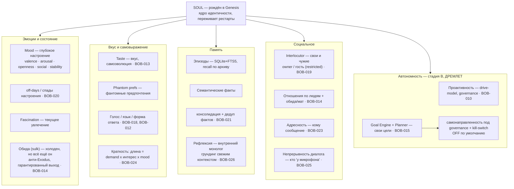
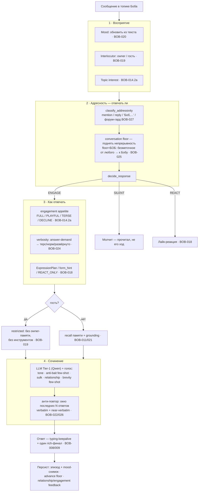
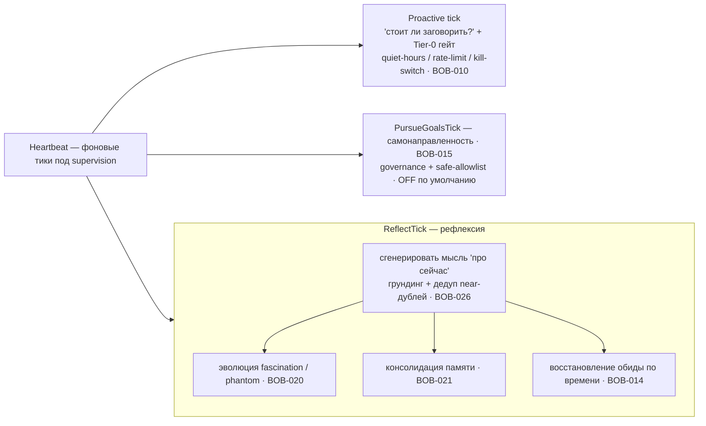
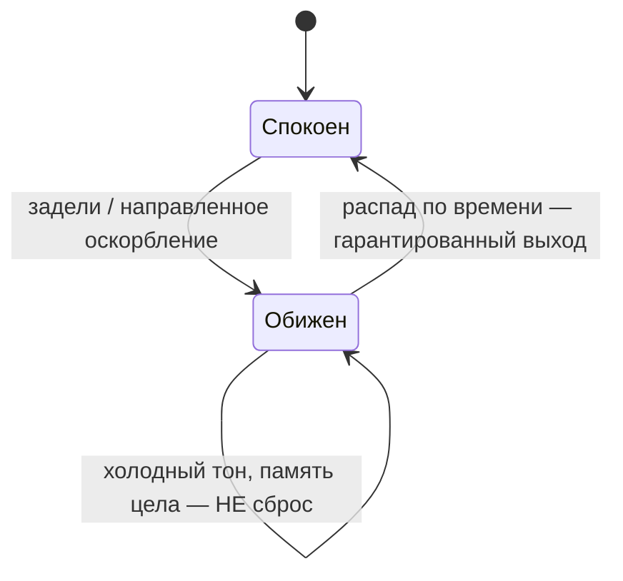
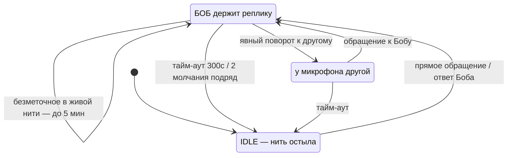
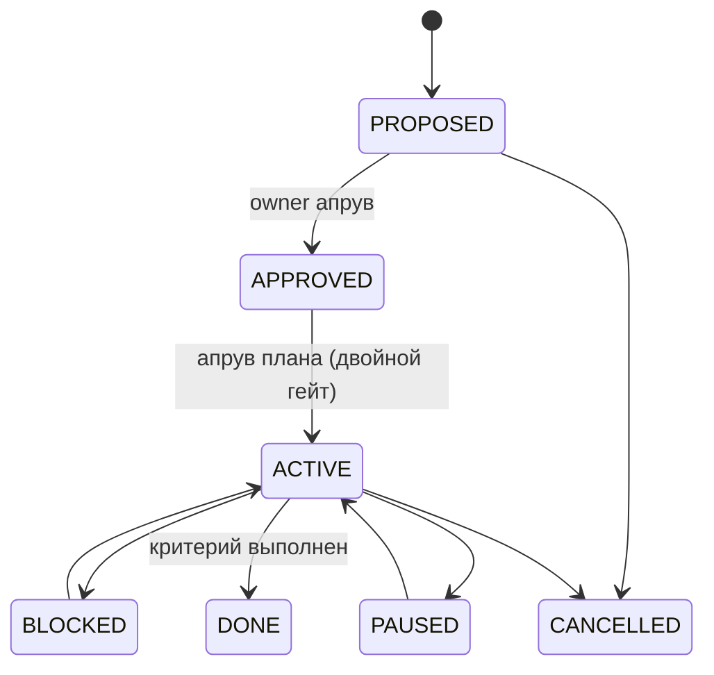

<!-- Copyright (c) 2026 Vladimir Zoologov. All Rights Reserved.
     SPDX-License-Identifier: BUSL-1.1 -->

# Личность Боба — карта (Mermaid)

> 📌 **Снапшот** (перенесён в `dev-docs` 2026-07-02, BOB-063). Исторический слепок; актуальную
> архитектуру см. `docs/` + `.claude/dev-docs/BOB-Issues.md`.
> Визуализация всей личностной системы Боба на 2026-06-24 (main `0452890`).
> Север: **никогда не выглядеть программно** — шаг за шагом к полноценной симуляции личности.
> Архитектура: DDD/Clean (домен чист ← application ← infrastructure); GUPPI — исполнитель;
> Qwen Tier-0/1 — подключаемый мозг; SQLite+FTS5 — память, переживающая рестарты.

---

## 1. Кто такой Боб — карта компонентов

---

## 2. Поток одного хода — как Боб решает и отвечает

---

## 3. Фоновая жизнь — Боб живёт между сообщениями

---

## 4. Машины состояний

### Настроение (sulk / обида) · BOB-014

### Непрерывность диалога (conversational floor) · BOB-025

### Цель (Goal Engine, автономность) · BOB-015

---

## 5. Легенда — компоненты и эпики

| Эпик | Что дал личности | Статус |
|------|------------------|--------|
| **BOB-001** | Личность MVP, SOUL/Genesis, Mood/Taste/Negotiation | ✅ |
| **BOB-010** | Проактивность (drive-model, governance) | ✅ |
| **BOB-011/021** | Память: гибридный recall + консолидация/дедуп | ✅ |
| **BOB-013** | Вкус + самоэволюция | ✅ |
| **BOB-014** | Отношения по людям + обида (анти-Exodus) + мат | ✅ |
| **BOB-018** | Выражение: ExpressionPlan / form_hint / REACT_ONLY | ✅ |
| **BOB-019** | Социальная идентичность: свои/чужие, гость (restricted) | ✅ |
| **BOB-020** | Эмоц. глубина: off-days, fascination, phantom-эволюция | ✅ |
| **BOB-022/026** | Анти-повтор: окно ответов + грундинг/дедуп рефлексии | ✅ |
| **BOB-023** | Адресность: кому сообщение (к Бобу / другому / в воздух) | ✅ |
| **BOB-024** | Краткость по запросу: длина как характер | ✅ |
| **BOB-025** | Непрерывность диалога (conversational floor) | ✅ |
| **BOB-027** | Фикс адресности в форум-топике (псевдо-reply на корень) | ✅ |
| **BOB-015** | Автономность (Goal Engine + Planner + самонаправленность) | ✅ дремлет |

> **Тир 1 «Личность в диалоге» — закрыт.** **Тир 2 «Автономность»** — T2.1 отгружено (дремлет).
> Дальше по роадмапу: T2.2 self-improvement, Тир 3 «Боб-кодер», Тир 4 медиа/FLUX.
