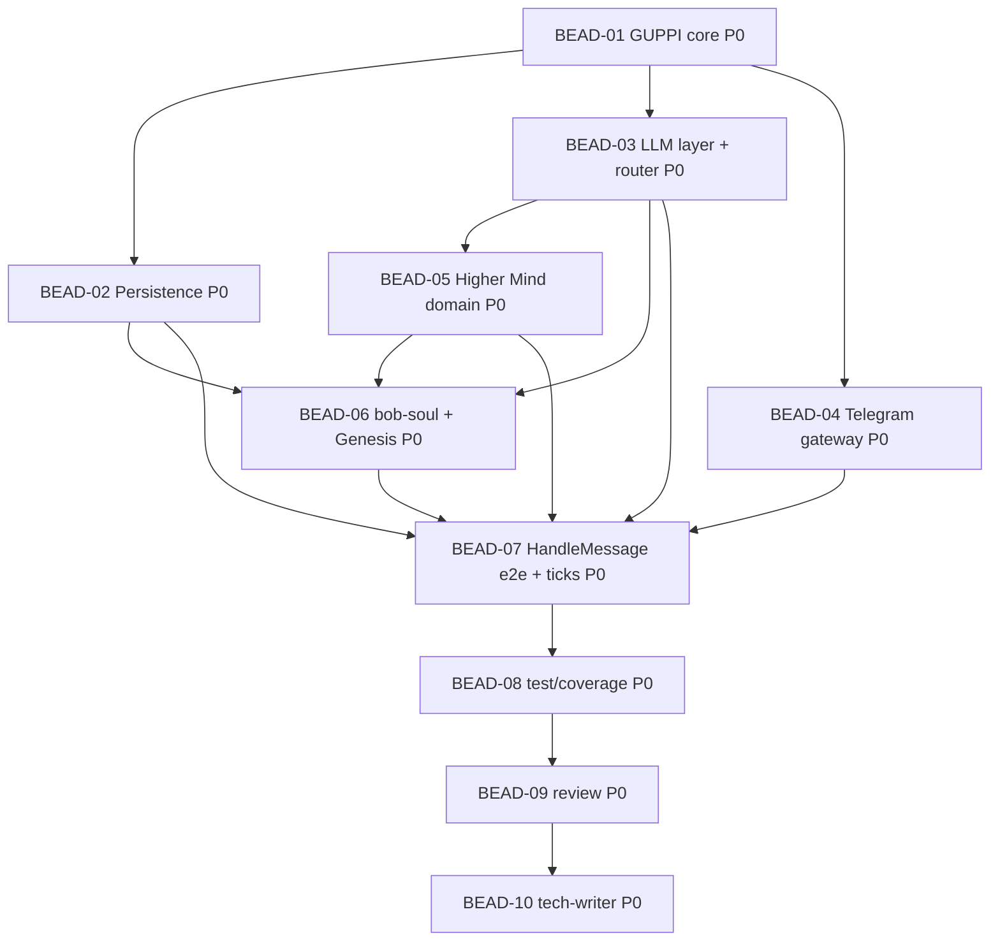

<!-- Copyright (c) 2026 Vladimir Zoologov. All Rights Reserved.
     SPDX-License-Identifier: BUSL-1.1 -->

# PLAN: BOB-001 — Личность Боба в Telegram

> **Status:** Approved
> **Created:** 2026-06-18

---

## Описание эпика

Реализовать P0: единый процесс **GUPPI** с Telegram-ботом, **LLMRouter** (Tier 0/1), памятью
(**SQLite + FTS5**), ядром личности (**Mood / Taste / Negotiation / SOUL**) и текстовым **Genesis**.
Семь dev-беадов по DDD-слоям + test / review / tech-writer.

## Зависимостный DAG

**Критический путь:** BEAD-01 → 03 → 05 → 06 → 07 → 08 → 09 → 10.
**Волны:** W1 = {01} · W2 = {02, 03, 04} парал. · W3 = {05} · W4 = {06} · W5 = {07} · затем 08 → 09 → 10.

## Беады

| ID | Название | Роль | Приоритет | Зависит от | Статус |
|----|----------|------|-----------|------------|--------|
| BEAD-01 | GUPPI core: AgentRuntime + EventBus + ConfigLoader + ports + `app.py` | dev | P0 | — | Pending |
| BEAD-02 | Persistence: SQLite schema + MemoryRepo + FTS5 recall + SoulStore | dev | P0 | 01 | Pending |
| BEAD-03 | LLM: OpenAICompatProvider (Tier 0/1) + LLMRouter + правило редакции | dev | P0 | 01 | Pending |
| BEAD-04 | Telegram Gateway: long-polling, дедуп, стриминг `editMessageText` | dev | P0 | 01 | Pending |
| BEAD-05 | Higher Mind domain: Mood / Taste / Negotiation / SOUL + текст-сигналы | dev | P0 | 03 | Pending |
| BEAD-06 | bob-soul шаблоны + Genesis use-case (пробуждение, запись SOUL) | dev | P0 | 02, 03, 05 | Pending |
| BEAD-07 | HandleMessage e2e + InnerMonologue/Reflect ticks (сборка потока) | dev | P0 | 02, 03, 04, 05, 06 | Pending |
| BEAD-08 | Тесты/покрытие ≥80% + edge cases + интеграция | test | P0 | 07 | Pending |
| BEAD-09 | Ревью: корректность / архитектура / безопасность / приватность | review | P0 | 08 | Pending |
| BEAD-10 | Доки: architecture (рус) + узлы beadloom + sync-check | tech-writer | P0 | 09 | Pending |

## Детали беадов

### BEAD-01: GUPPI core
**Done when:** процесс стартует/останавливается graceful; `AgentRuntime` крутит asyncio-loop;
`EventBus` (publish/subscribe) работает; `ConfigLoader` (defaults → YAML → env); порты-протоколы в
`domain/ports.py`; `app.py` собирает заглушки. Тесты на loop/bus/config зелёные.

### BEAD-02: Persistence
**Done when:** `schema.sql` (episodic_log, semantic_memory + FTS5, mood, taste_axes, relationship, kv);
`SqliteMemoryRepo` реализует `MemoryRepo`; `MemoryRecall` через FTS5 (keyword); `SoulStore` чтение/запись
`data/soul/`; миграции; WAL. Состояние переживает рестарт (тест).

### BEAD-03: LLM layer + router
**Done when:** `OpenAICompatProvider(base_url, model, key)` (стриминг + non-stream); фабрика Tier 0
(mlx-lm) / Tier 1 (Qwen) по конфигу; `LLMRouter` классифицирует задачу → Tier + **правило редакции**
личного контекста; fallback Tier 1→Tier 0. Тесты с фейковым провайдером.

### BEAD-04: Telegram Gateway
**Done when:** приём апдейтов (long-polling), дедуп; публикация `MessageReceived` в EventBus; стриминг
ответа через батч `editMessageText` с троттлингом; транспорт без Higher-Mind-логики. Тесты на дедуп/батч.

### BEAD-05: Higher Mind domain
**Done when:** `Mood` (valence/arousal/…), `TasteEngine` (оси + conviction + оценка), `Negotiation`
(текстовые зоны), `SOUL` — чистая доменная логика; `UpdateMoodFromText` (Tier 0 сентимент + сигналы:
частота/время/presence). Влияние на тон/оценку детерминированно тестируемо.

### BEAD-06: bob-soul + Genesis
**Done when:** каталог `bob-soul/` (архетип, пул черт, оси вкусов, mood-baselines, фантомные
предпочтения); `RunGenesis` генерит личность (Tier 1) при отсутствии SOUL, пишет `data/soul/`,
проигрывает «пробуждение»; повторно не запускается (флаг). Тест: один запуск, персистентность.

### BEAD-07: HandleMessage e2e + ticks
**Done when:** полный поток: update → mood-апдейт → recall + личность → router (Tier1+редакция/Tier0) →
стриминг-ответ → персист эпизода/фактов; heartbeat-тик (InnerMonologue, дрейф mood, Reflect).
Интеграционный прогон на фейках зелёный.

### BEAD-08: test/coverage
**Done when:** покрытие ≥80%; edge cases (обрыв API → fallback, дедуп, рестарт-память, приватность —
сырьё не уходит в Tier 1); `uv run pytest` зелёный.

### BEAD-09: review
**Done when:** ревью корректности/архитектуры (слои), безопасности и **приватности** (редакция);
находки в комментарии беада; код не правится.

### BEAD-10: tech-writer
**Done when:** `docs/` архитектура на русском; узлы beadloom (`_graph`) под новые домены; `beadloom
reindex` + `sync-check` 0 stale; `beadloom ci` зелёный.
