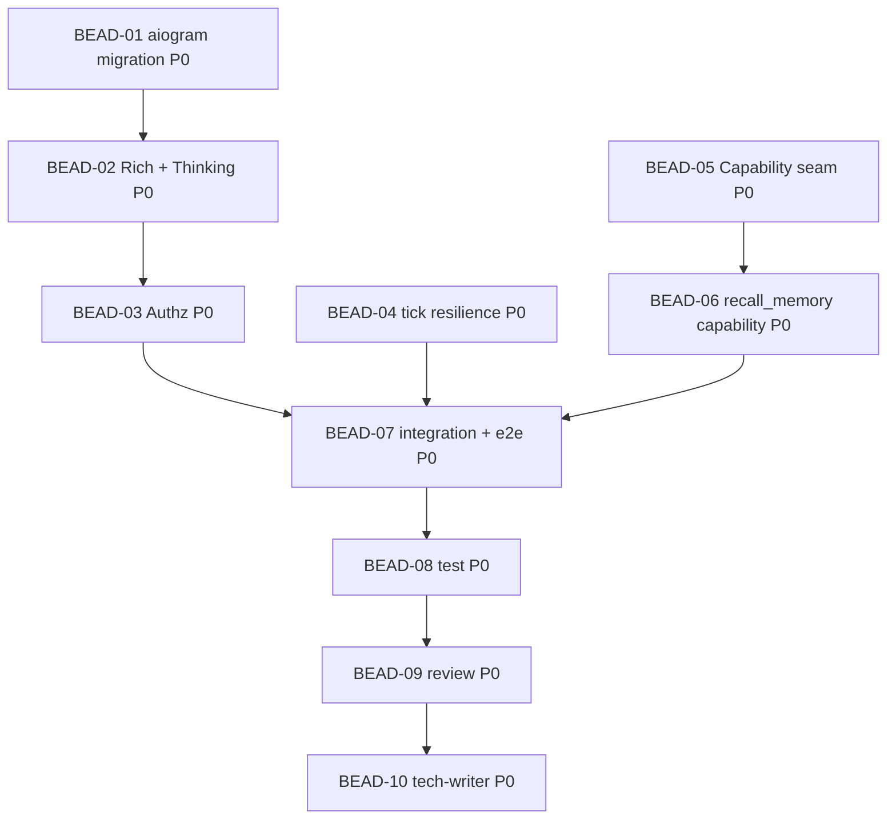

<!-- Copyright (c) 2026 Vladimir Zoologov. All Rights Reserved.
     SPDX-License-Identifier: BUSL-1.1 -->

# PLAN: BOB-002 — Rich/стриминг + Authz + Резилентность + Capability-шов

> **Status:** Approved
> **Created:** 2026-06-19

---

## Описание эпика

Четыре трека за существующими портами: **aiogram-миграция** + нативный rich/стрим/thinking ·
**Authz** (owner/allowlist/chat-scope) · **резилентность** тиков · **Capability-шов** (контракт + реестр
+ tool-loop + манифест). Telegram-беады идут цепочкой (один пакет), остальные — параллельно. Сборка
во-вне-app.py — отдельным интеграционным беадом (как BOB-001), чтобы не было гонок на `app.py`.

## Зависимостный DAG

**Волны:** W1 = {D1, D4, D5} ∥ · W2 = {D2, D6} ∥ · W3 = {D3} · W4 = {D7} · затем 08 → 09 → 10.
**Гонки:** Telegram-беады (01→02→03) — цепочкой (общий пакет). D4/D5 — disjoint, параллельно. Только
D1 трогает `app.py` (конструкция gateway); D4/D5/D6 откладывают свою сборку на D7.

## Беады

| ID | Название | Роль | Приоритет | Зависит от | Статус |
|----|----------|------|-----------|------------|--------|
| BEAD-01 | dev: миграция gateway на **aiogram** (long-polling, дедуп, `sendMessageDraft`) + dep + app.py-gateway | dev | P0 | — | Pending |
| BEAD-02 | dev: Rich Messages + `RichBlockThinking` + `MarkdownToRichMessage` + fallback на plain | dev | P0 | 01 | Pending |
| BEAD-03 | dev: Authz — `Authorizer` + единый гейт в gateway (owner/allowlist/chat-scope) + kv-стор + `/authorize` | dev | P0 | 02 | Pending |
| BEAD-04 | dev: резилентность тиков — `retry_with_backoff` (инъекция sleep) + изоляция тиков | dev | P0 | — | Pending |
| BEAD-05 | dev: Capability-шов — контракт + `CapabilityRegistry` + tool-calling в провайдере + tool-loop + манифест | dev | P0 | — | Pending |
| BEAD-06 | dev: capability `recall_memory` (обёртка над `MemoryRecall`) | dev | P0 | 05 | Pending |
| BEAD-07 | dev: интеграция — сборка реестра/capabilities/резилентности в `app.py` + e2e | dev | P0 | 03, 04, 06 | Pending |
| BEAD-08 | test: покрытие ≥80% + приёмка (authz-отказ, rich-fallback, retry, tool-loop, thinking) | test | P0 | 07 | Pending |
| BEAD-09 | review: корректность / DDD / безопасность (authz, без утечки токена) / приватность | review | P0 | 08 | Pending |
| BEAD-10 | tech-writer: доки (рус) + узлы/граф beadloom + sync | tech-writer | P0 | 09 | Pending |

## Детали беадов

### BEAD-01: aiogram migration
**Done when:** `infrastructure/telegram/*` переписан на **aiogram ≥3.29.0** (Dispatcher/Router,
long-polling, дедуп апдейтов), стрим через `sendMessageDraft`, паритет с прежним поведением; порт
`ReplyStreamer`/EventBus сохранён; `pyproject` dep `python-telegram-bot`→`aiogram`; app.py-конструкция
gateway обновлена. Тесты на fake-aiogram (без сети). PTB удалён.

### BEAD-02: Rich + Thinking
**Done when:** `MarkdownToRichMessage` (чистый конвертер md→дерево aiogram `RichMessage`); ответ через
`sendRichMessage`/`sendRichMessageDraft`; опц. `thinking` → `RichBlockThinking`; **fallback на plain** при
ошибке. НЕ `editMessageText`+rich. Тесты конвертера + fallback.

### BEAD-03: Authz
**Done when:** `Authorizer` (owner/allowed_chats/allowlist); **единый гейт в gateway** — не-allowlist
user / не-разрешённый chat → молчаливый игнор; kv-стор (SQLite) для рантайм-allowlist; owner-команда
`/authorize <user_id>`. Тест: чужой `user_id`/`chat_id` отсечён; owner авторизует.

### BEAD-04: tick resilience
**Done when:** `retry_with_backoff` (инъекция sleep/Clock) на транзиентных ошибках; heartbeat-тик
переживает сбой и не валит петлю/соседние тики. Тесты на транзиент vs перманент.

### BEAD-05: Capability seam
**Done when:** контракт `Capability` (имя/описание/JSON-схема/`async execute`/permission);
`CapabilityRegistry` (register/manifest/dispatch); `OpenAICompatProvider` читает/отдаёт `tools`/
`tool_calls`; tool-use петля в `HandleMessage` (опц. registry, дефолт пуст → app.py не обязателен);
манифест в контексте. Тесты на fake-провайдере с реалистичным tool-call. Ранняя проверка MaaS tools.

### BEAD-06: recall_memory capability
**Done when:** `recall_memory(query)` — capability-обёртка над `MemoryRecall`; зарегистрирована;
tool-loop e2e на фейках: модель зовёт `recall_memory` → результат → ответ. Тест.

### BEAD-07: integration + e2e
**Done when:** в `app.py` собраны `CapabilityRegistry` + `recall_memory` + резилентные тики +
aiogram-gateway; e2e на фейках (authz, rich-fallback, tool-loop, thinking, retry). Зелёный прогон.

### BEAD-08: test
**Done when:** покрытие ≥80%; приёмка US-1..US-4 (rich/стрим/thinking, authz-отказ, резилентность,
tool-loop/манифест); ruff + mypy --strict; реалистичные reasoning-формы.

### BEAD-09: review
**Done when:** ревью корректности/DDD/безопасности (**authz без обхода**, токен не утекает)/приватности;
находки в комментарии; код не правится.

### BEAD-10: tech-writer
**Done when:** `docs/` (рус) под aiogram/rich/authz/резилентность/capabilities; узлы beadloom; `beadloom
ci` зелёный, sync-check 0.
