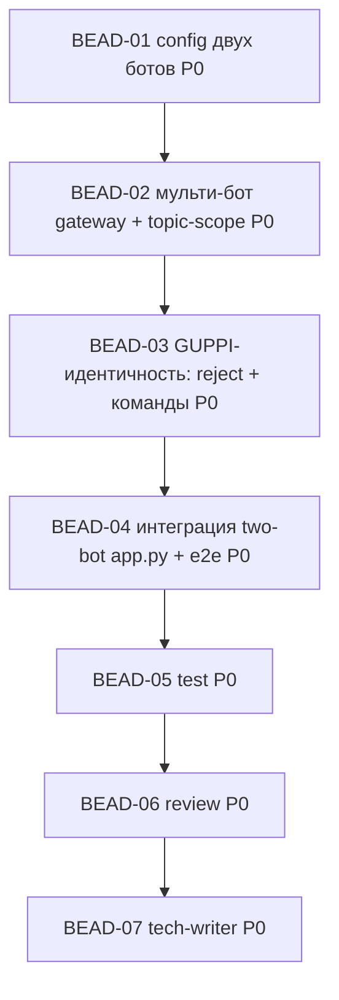

<!-- Copyright (c) 2026 Vladimir Zoologov. All Rights Reserved.
     SPDX-License-Identifier: BUSL-1.1 -->

# PLAN: BOB-003 — GUPPI-бот (мульти-бот gateway) + topic-scope

> **Status:** Approved
> **Created:** 2026-06-19

---

## Описание эпика

Эпик gateway-центричный → DAG в основном **линейный** (общий пакет `infrastructure/telegram`, единый
роутер): конфиг двух ботов → мульти-бот gateway + topic-scope → GUPPI-идентичность (reject + команды) →
интеграция → test/review/tech-writer. Параллелить нечего (один роутер), зато волны простые и без гонок.

## Зависимостный DAG

**Волны:** W1 {D1} → W2 {D2} → W3 {D3} → W4 {D4} → 05 → 06 → 07 (линейно).

## Беады

| ID | Название | Роль | Приоритет | Зависит от | Статус |
|----|----------|------|-----------|------------|--------|
| BEAD-01 | dev: конфиг двух ботов (bob/guppi токены, GUPPI env-маппинг, chat_id/topic_id/owner_id) | dev | P0 | — | Pending |
| BEAD-02 | dev: мульти-бот gateway (`BotRegistry` + 2-бот поллинг + центр. роутер + кросс-бот дедуп + identity-routing) + Bob topic-scope/thread-reply | dev | P0 | 01 | Pending |
| BEAD-03 | dev: GUPPI-идентичность — reject «не авторизован» (Боб не вызывается) + owner-команды `/authorize`,`/status` в General + перенос authz | dev | P0 | 02 | Pending |
| BEAD-04 | dev: интеграция — два бота в `app.py` + e2e | dev | P0 | 03 | Pending |
| BEAD-05 | test: ≥80% + приёмка US-1..US-4 | test | P0 | 04 | Pending |
| BEAD-06 | review: безопасность (без двойной обработки, без обхода authz, reject-корректность, токены из env) + DDD | review | P0 | 05 | Pending |
| BEAD-07 | tech-writer: доки (рус) + операционная заметка (боты-админы/токены) + узлы beadloom + Gate | tech-writer | P0 | 06 | Pending |

## Детали беадов

### BEAD-01: config двух ботов
**Done when:** `telegram`-секция реструктурирована под два бота: `telegram.bob.token` (env `BOB_TELEGRAM__TOKEN`)
+ `telegram.guppi.token` (env `GUPPI_TELEGRAM__TOKEN` — **явный маппинг**, нестандартный префикс);
`chat_id`, `bob.topic_id`, `owner_id`, `allowed_chat_ids`. `bob.example.yaml` обновлён. Тесты лоадера
(оба токена, дефолты). Обратная совместимость существующих ключей по возможности.

### BEAD-02: мульти-бот gateway + topic-scope
**Done when:** `BotRegistry` (регистрация `{identity, token, handlers, scope}`); один Dispatcher поллит
**оба бота**; **центральный роутер** `(update, bot_identity)`; **кросс-бот дедуп** по `(chat_id, message_id)`;
identity-routing. **Topic-scope Боба:** хендлер обрабатывает только `chat_id==bob.chat_id` И
`message_thread_id==bob.topic_id`; отправка проставляет `message_thread_id` (ответ в тред). Изоляция
ботов. Тесты на фейк-ботах (дедуп, роутинг, topic-фильтр, thread-reply). Порт `ReplyStreamer` сохранён.

### BEAD-03: GUPPI-идентичность
**Done when:** маршрут «топик Боба + НЕ авторизован» → **GUPPI** шлёт «⛔ Пользователь не авторизован»,
**пайплайн Боба не запускается**; «General + owner-команда» → GUPPI обрабатывает `/authorize <user_id>`
(+ `/status`, опц. `/deauthorize`), только owner, через `Authorizer`/`KvAllowlistStore`; DM незнакомца —
молчим. Тесты: чужой → reject от GUPPI + Боб не вызван; owner `/authorize` авторизует; не-owner команду игнор.

### BEAD-04: интеграция two-bot + e2e
**Done when:** `app.py` строит **оба бота** (токены из env) и регистрирует в gateway; `build_application`
поднимает мульти-бот gateway. e2e на фейках: (a) чужой в топике → GUPPI reject, Боб не вызван;
(b) авторизованный в топике → Боб отвечает **в тред**; (c) owner `/authorize` в General → GUPPI; (d) General/
другой топик → игнор. Зелёный прогон.

### BEAD-05: test
**Done when:** покрытие ≥80%; приёмка US-1..US-4 (Боб в топике/thread-reply; GUPPI reject + Боб не вызван;
owner-команды; мульти-бот дедуп/изоляция); ruff + mypy --strict; фейк-боты.

### BEAD-06: review
**Done when:** ревью безопасности (**без двойной обработки**, **authz без обхода**, reject-корректность,
оба токена из env/не логируются) + DDD/корректность; находки в комментарии; код не правится.

### BEAD-07: tech-writer
**Done when:** `docs/` (рус) под мульти-бот/GUPPI/topic-scope; **операционная заметка** (боты-админы,
два токена в env); узлы beadloom; `beadloom ci` зелёный, sync-check 0.
