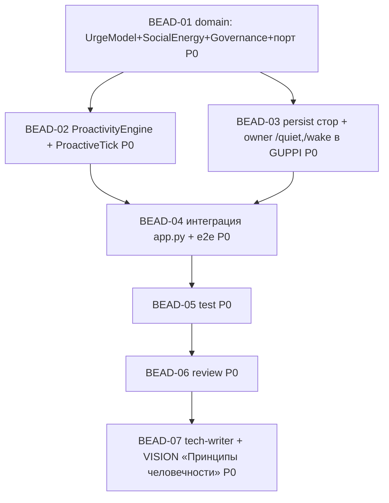

<!-- Copyright (c) 2026 Vladimir Zoologov. All Rights Reserved.
     SPDX-License-Identifier: BUSL-1.1 -->

# PLAN: BOB-010 — Эпик «Живой Боб»: человечность

> **Status:** Approved
> **Created:** 2026-06-20

---

## Описание эпика

3 фазы, каждая — **шиппимый срез** + **live-тюнинг** перед следующей (человечность субъективна → тюним
с owner). **Беады создаём пофазно:** Фаза 1 — сейчас; Фазы 2/3 — на старте фазы (после live-тюнинга
предыдущей информирует следующую). Ниже детально Фаза 1; Фазы 2/3 — контур.

## Фаза 1 — Проактивность (drive-движок) — беады сейчас

### Зависимостный DAG (Фаза 1)

**Волны:** W1 {D1} → W2 {D2, D3} ∥ → W3 {D4} → D5 → D6 → D7.

### Беады (Фаза 1)

| ID | Название | Роль | Зависит от |
|----|----------|------|------------|
| BEAD-01 | dev: domain — `UrgeModel` (чистая формула) + `SocialEnergy` + `Governance` value-objects + порт стора; инъекция Clock/seed | dev | — |
| BEAD-02 | dev: `ProactivityEngine` + `ProactiveTick` (urge→стохастика→governance→Tier-0-гейт→компоновка тирингом→постинг в Bob/32) | dev | 01 |
| BEAD-03 | dev: per-persona стор (social_energy/last_spoke/last_user_msg/enabled) + owner-команды `/quiet`,`/wake` в GUPPI | dev | 01 |
| BEAD-04 | dev: интеграция — движок+стор+тик+команды в `app.py` + e2e (fire/governance/quiet/mute) | dev | 02, 03 |
| BEAD-05 | test: ≥80% + приёмка US-1/US-2 (порыв из состояния, стохастика, потолки, дёшево) | test | 04 |
| BEAD-06 | review: корректность/DDD/детерминизм (Clock/seed), без регрессий, без анти-человечных паттернов | review | 05 |
| BEAD-07 | tech-writer: доки (рус) + **VISION «Принципы человечности» + трек** + Gate | tech-writer | 06 |

### Детали (Фаза 1)

**BEAD-01:** `UrgeModel.urge(mood, silence, salience, tod_local, energy)->float`; `SocialEnergy` (recover/
spend); `Governance` (quiet-hours floor, anti-spam max, min-gap, cooldown, mute-flag) — чистые, инъекция
Clock/seed; порт `ProactivityStore`. Тесты формул/потолков.

**BEAD-02:** `ProactivityEngine`: на тике обновить energy → urge → governance-veto → seeded-сэмпл; при fire —
Tier-0-гейт («сказать ли и о чём», дефолт skip) → компоновка (router/тиринг) → постинг в Bob/32 (gateway).
`ProactiveTick` для heartbeat. Тесты на фейках LLM/gateway/clock/seed: fire/no-fire, дефолт-молчать, дёшево.

**BEAD-03:** SQLite per-persona стор (`ProactivityStore`): energy/last_spoke/last_user_msg/enabled (персист);
`/quiet` (+опц `2h`), `/wake` в GUPPI (только owner) → флаг. Тесты персиста/команд.

**BEAD-04:** `app.py`: собрать движок+стор, зарегистрировать `ProactiveTick` в heartbeat (с RetryPolicy),
прокинуть команды в GUPPI. e2e на фейках: fire→постинг в тред Боба; quiet-hours/mute/cooldown veto;
ответ owner гасит energy.

**BEAD-05..07:** приёмка/ревью/доки как обычно; BEAD-07 дополнительно фиксирует «Принципы человечности» в VISION.

## Фаза 2 — Выражение (контур; беады на старте фазы)

Реакции (`setMessageReaction`) вместо/вместе с ответом · протекающая reflect-жизнь («пока тебя не было…»)
· шейпер переменной формы (мульти-короткие) · переменная пауза + колбэки в память + брошенные темы.
Зависит от Фазы 1 + live-тюнинга.

## Фаза 3 — Отношения и эмоции (контур; беады на старте фазы)

`Relationship` (близость растёт) · эмоции в две стороны (входы mood) · мнения/несогласие (Negotiation) ·
не-вечно-услужлив (off-days) · `Fascination` (увлечение, дрейф). Зависит от Фаз 1–2 + тюнинга.

> **Вне эпика:** «своя жизнь»/агентность вне чата (инструменты/Goal Engine) → эпик #5-B/C; bot-to-bot → Bobiverse.
