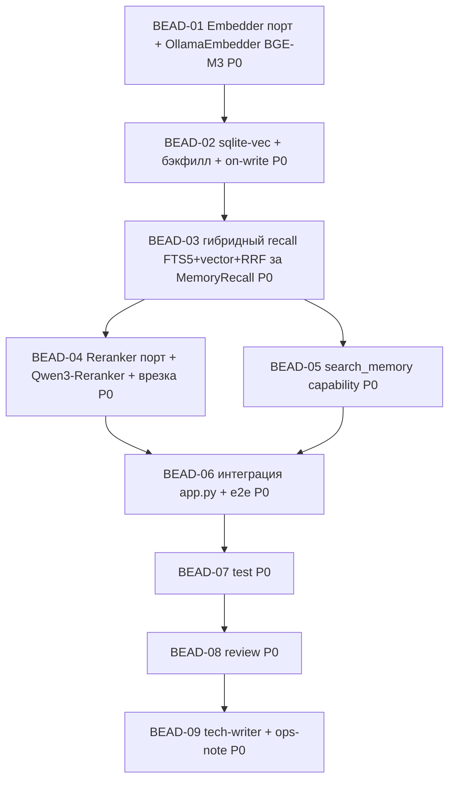

<!-- Copyright (c) 2026 Vladimir Zoologov. All Rights Reserved.
     SPDX-License-Identifier: BUSL-1.1 -->

# PLAN: BOB-011 — Эпик «Память Боба»

> **Status:** Approved
> **Created:** 2026-06-20

---

## Описание эпика

2 фазы, беады пофазно. **Ф1 — сейчас:** семантический/гибридный recall + реранкер + агентный
`search_memory`. Пайплайн памяти линеен по природе (эмбеддер → стор → recall), затем реранкер/search
параллельно. Реранкер — **отдельным беадом**, чтобы Q1 (подача) не держал остальное (гибрид шиппится сам).

## Фаза 1 — Семантика + гибрид + реранкер + search_memory

### Зависимостный DAG (Фаза 1)

**Волны:** W1 {D1} → W2 {D2} → W3 {D3} → W4 {D4, D5} ∥ → W5 {D6} → D7 → D8 → D9.

### Беады (Фаза 1)

| ID | Название | Роль | Зависит от |
|----|----------|------|------------|
| BEAD-01 | dev: `Embedder` порт + `OllamaEmbedder` (BGE-M3 dense 1024 через Ollama, батч/ретрай) + конфиг | dev | — |
| BEAD-02 | dev: sqlite-vec (расширение + `vec0`-схема) + бэкфилл фактов/эпизодов + on-write embed | dev | 01 |
| BEAD-03 | dev: гибридный recall за `MemoryRecall` (FTS5 BM25 + sqlite-vec KNN → RRF), drop-in + фоллбэк на keyword | dev | 02 |
| BEAD-04 | dev: `Reranker` порт + Qwen3-Reranker (Q1 подача) + врезка в recall (top-K→top-N) | dev | 03 |
| BEAD-05 | dev: `search_memory` capability (агентный поиск через tool-loop) | dev | 03 |
| BEAD-06 | dev: интеграция — embedder/sqlite-vec/гибрид/reranker/search_memory в app.py + конфиг Ollama + e2e + graceful fallback | dev | 04, 05 |
| BEAD-07 | test: ≥80% + приёмка US-1/2/3 (семантика > keyword, search_memory, локальность) на фейках | test | 06 |
| BEAD-08 | review: корректность/DDD/**приватность** (контент памяти не наружу)/фоллбэк | review | 07 |
| BEAD-09 | tech-writer: доки (рус) + **операционная заметка (Ollama setup)** + Gate | tech-writer | 08 |

### Детали (Фаза 1)

**BEAD-01:** `Embedder.embed(texts)->vectors`; `OllamaEmbedder` (POST на локальный Ollama, `bge-m3`, dim 1024,
батч, ретрай BOB-002). Конфиг `embeddings.{base_url,model,dim}`. Фейк-эмбеддер для тестов. Без сети в CI.

**BEAD-02:** загрузка `sqlite-vec`; `vec0` virtual table `memory_vec(embedding float[1024])` ↔ semantic/episodic;
идемпотентный **бэкфилл** существующего (батч); **on-write** эмбеддинг новых факта/эпизода. Тесты на фейк-эмбеддере.

**BEAD-03:** `MemoryRecall` impl: FTS5 top-K + sqlite-vec KNN top-K → **RRF**-слияние → результат (tag source).
**Фоллбэк:** эмбеддер недоступен → чистый FTS5. Drop-in (потребители не меняются). Тесты: семантика находит без слов.

**BEAD-04:** `Reranker.rerank(query,candidates)->ranked`; Qwen3-Reranker локально (**Q1:** Ollama-scorer/промпт-логиты;
порт абстрактный). Врезка как стадия top-K→top-N в recall. Фоллбэк: нет reranker → гибрид как есть. Тесты на фейке.

**BEAD-05:** capability `search_memory(query,k)` — агентный поиск (гибрид+реранк) через tool-loop; e2e на фейках
(модель зовёт search_memory → результат в ответе). `recall_memory` остаётся (обёртка).

**BEAD-06:** `app.py` собирает embedder+sqlite-vec+гибрид+reranker+search_memory; конфиг Ollama; graceful fallback.
e2e на фейках: семантический recall, search_memory, фоллбэк при «нет Ollama».

**BEAD-07..09:** приёмка/ревью(приватность)/доки+ops-note(Ollama) как обычно.

## Фаза 2 — Консолидация (контур; беады на старте фазы)

Всплытие очень старого · суммаризация/дайджесты длинной памяти · дедуп/слияние фактов · память-рефлексия.
Зависит от Ф1 + тюнинга.

> **Вне эпика:** внешний RAG над доками/вебом → P3; мультимодальная память → позже.
