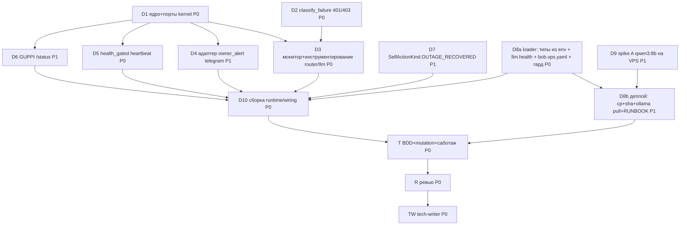

<!-- Copyright (c) 2026 Vladimir Zoologov. All Rights Reserved.
     SPDX-License-Identifier: BUSL-1.1 -->

# PLAN: BOB-116 — Здоровье LLM-стека: состояние, сигнал владельцу, зонд, выкатка

> **Status:** Done
> **Завершён:** 2026-10-21 (ветка `features/BOB-116`)
> **Created:** 2026-10-21

---

## Epic Description

Реализовать RFC BOB-116: чистое ядро здоровья провайдера + порты (kernel), политика `classify_failure`
с 401/403 → дублёр, монитор и инструментирование роутера/дублёр-обёртки, адаптер сигнала владельцу,
гейт-зонд дорожек heartbeat, `/status` GUPPI, эпизод автобиографии, трекаемый конфиг VPS + деплой,
spike A; затем BDD + mutation, ревью, доки. Родитель — существующая беада `bob-i83` (feature).

## Dependency DAG

**Critical path:** D1 → D3 → D10 → T → R → TW

**Волны:** W1 = D1 · D2 · D7 · D8a · D9 (параллельно, файлы не пересекаются) → W2 = D3 · D4 · D5 · D6 ·
D8b → W3 = D10 → T → R → TW. Один файл — один агент в волне.

## Beads

| ID | Tracker | Name | Priority | Depends On |
|---|---|---|---|---|
| D1 | bob-i83.1 | Ядро `kernel/provider_health.py` + порты `HealthObserver`/`HealthReader`/`OwnerAlertSink`/`HealthView` | P0 | - |
| D2 | bob-i83.2 | `classify_failure` + 401/403 → `auth` → дублёр; тесты политики; S-new в `tier0_fallback.feature`; харнесс `FORBIDDEN/UNAUTHORIZED` | P0 | - |
| D7 | bob-i83.3 | `SelfActionKind.OUTAGE_RECOVERED` + `_content_for` от первого лица | P1 | - |
| D8a | bob-i83.4 | Лоадер: приведение env к типу дефолта (int/bool/список int), блок `llm.health`; трекаемый `config/bob.vps.yaml` без секретов/id; гард-тест | P0 | - |
| D9 | bob-i83.5 | Spike A: `qwen3:8b` на VPS — замер по критериям RFC, решение A/выключено | P1 | - |
| D3 | bob-i83.6 | `ProviderHealthMonitor` + `health_messages`; доклад исходов из `LLMRouter` и `FallbackLLMProvider`; лог одной строкой | P0 | D1, D2 |
| D4 | bob-i83.7 | Адаптер `infrastructure/telegram/owner_alert.py` (бот Боба, личка) | P1 | D1 |
| D5 | bob-i83.8 | `health_gated` в `application/runtime/heartbeat.py` (пропуск/зонд/лог без стека) | P0 | D1 |
| D6 | bob-i83.9 | GUPPI `/status` со снимком; `HealthReader` через `MultiBotGateway._build_guppi` | P1 | D1 |
| D8b | bob-i83.10 | Деплой: `cp` конфига + sha-гард + предусловие `.env` + `ollama pull` по конфигу; RUNBOOK/bootstrap; результат spike в конфиг | P1 | D8a, D9 |
| D10 | bob-i83.11 | Сборка: `composition.py`, `wiring/proactivity.py` (гейты дорожек), `wiring/telegram.py`, `wiring/self_action.py`, `factory.py` (sign-on «дублёр включён, модели нет») | P0 | D3, D4, D5, D6, D7, D8a |
| T | bob-i83.12 | `llm_health.feature` + steps (loopback + фейковый sink), mutation на ядре и политике, тесты рисков RFC (двойной учёт, ошибка БД в degraded, список id из env), саботаж с именами | P0 | D10, D8b |
| R | bob-i83.13 | Ревью: DDD-границы, Cohesion, BDD-покрытие сценариев PRD, mutation-score, гейты на чистом индексе релизной сборкой | P0 | T |
| TW | bob-i83.14 | Доки: `docs/architecture.md`, `docs/domains/*` (router, llm, telegram, runtime, memory, config), VISION §7.1, Issues #64, ROADMAP, ACTIVE/CONTEXT → Done | P0 | R |

## Bead Details

### D1: Ядро `kernel/provider_health.py` + порты

**Priority:** P0 · **Depends on:** - · **Blocks:** D3, D4, D5, D6

**What to do:** TDD: `HealthState`, `HealthPolicy` (дефолты RFC, `failures_threshold < 2` → `ValueError`),
`ProviderHealth` (frozen, slots), `Transition`; функции модуля `on_failure`, `on_success`, `probe_due`,
`next_probe_interval`, `outage_duration`. Порты в `kernel/ports.py`: `HealthObserver`, `HealthReader`,
`OwnerAlertSink`, `HealthView` (frozen dataclass для снимка). `pyproject.toml [tool.mutmut].source_paths`
+= `src/bob/kernel/provider_health.py`. Файлы: `src/bob/kernel/provider_health.py`, `src/bob/kernel/ports.py`,
`tests/kernel/test_provider_health.py`, `pyproject.toml`.

**Done when:**
- [ ] переходы: порог по числу **и** по длительности (что раньше), `DEGRADED` один раз, `REMINDER` по
      расписанию с потолком на последнем интервале, `RECOVERED` только из `DEGRADED`, допороговые отказы
      сбрасываются без перехода
- [ ] `probe_due`: в `HEALTHY` всегда True; в `DEGRADED` — по `probe_s` от `last_probe_at`, потолок — последний
- [ ] `scripts/mutation.sh kernel.provider_health` ≥ 85 % с числом мутантов и триажем в комментарии беады
- [ ] `kernel` импортирует только stdlib (lint на чистом индексе)

### D2: `classify_failure` + 401/403 → дублёр

**Priority:** P0 · **Depends on:** - · **Blocks:** D3

**What to do:** `classify_failure(exc) -> str` в `fallback_policy.py` (классы RFC); `should_fall_back`
через неё; докстринг-контракт `:55-57` переписан (auth = недоступность для маршрутизации, contract —
наружу). `tests/application/router/test_fallback_policy.py:173-177`: 401/403 переезжают; параметризация
`classify_failure`. `tier0_fallback.feature`: сценарии `403 на Tier-0 при подключённом дублёре → ответ
приходит от дублёра` и `401 …` (имена PRD) + харнесс `FORBIDDEN`/`UNAUTHORIZED`
(`tier0_fallback_harness.py:68-75, 166-198`). Файлы: `fallback_policy.py`, его тест, харнесс, feature,
steps `test_tier0_fallback.py`.

**Done when:**
- [ ] 401/403 → `auth` → `should_fall_back` True; 400/404/409/413/422 → `contract` → False; 429 → `rate`;
      5xx/408 → `server`; таймаут/обрыв/битое тело — как прежде
- [ ] оба новых сценария зелёные на настоящем loopback; S7/S23 (400) без изменений
- [ ] mutation `application.router.fallback_policy` ≥ 85 %, число мутантов названо

### D7: `SelfActionKind.OUTAGE_RECOVERED`

**Priority:** P1 · **Depends on:** - · **Blocks:** D10

**What to do:** `memory/self_action.py:50` новый kind; `_content_for` (`:128-169`) — «Я молчал с … по …:
<класс по-человечески>, думать было нечем. Теперь снова могу.»; `detail` несёт `since/until/
failure_class/provider`; форматирование длительности/дат по-русски. Тесты рядом с существующими.

**Done when:**
- [ ] текст от первого лица для `auth/rate/server/timeout/connection`; визибилити — `owner_private`
      (как coding, `coding_assistant.py:618-631`)
- [ ] существующие тесты `self_action` зелёные

### D8a: Лоадер + трекаемый конфиг VPS

**Priority:** P0 · **Depends on:** - · **Blocks:** D8b, D10

**What to do:** `infrastructure/config/loader.py`: дефолты `llm.health` (`:63-93`); `_assign_nested`/
`_load_env` (`:652-681`) приводят env-значение к типу дефолта: `int`, `float`, `bool` (`true/false/1/0`),
список `int` через запятую (для `allowed_chat_ids`), строка иначе; неприводимое значение — `ValueError`
с именем ключа. `config/bob.vps.yaml` (новый, трекаемый): полный конфиг прода по образцу текущего VPS
(`runtime`, `telegram` без id, `llm` с `health`, `embeddings`, `memory.autobiography` — значение по Q5),
комментарий-шапка «id и секреты — только `.env`»; `config/bob.vps.example.yaml` → указатель на него;
`config/bob.example.yaml` + блок `health`. Гард-тест `tests/infrastructure/config/test_vps_config_is_clean.py`:
в `config/bob.vps.yaml` нет значений у ключей `*token*`, `*key*`, `chat_id`, `owner_id`, `allowed_chat_ids`,
`topic_id`, `owner_dm_chat_id` и нет чисел длиннее 5 цифр; загрузка `ConfigLoader(yaml_path=bob.vps.yaml,
env={BOB_TELEGRAM__OWNER_ID: "123", BOB_TELEGRAM__ALLOWED_CHAT_IDS: "-1,-2", …})` даёт типизированные
значения.

**Done when:**
- [ ] список id из env — `list[int]`; `bool`/`int` приводятся; тест на реальном `ConfigLoader`
- [ ] гард-тест краснеет на подсунутом id (саботаж с именем)
- [ ] `tier0_fallback` в трекаемом конфиге — **выключен** до D9/D8b (явный комментарий)

### D9: Spike A — `qwen3:8b` на VPS

**Priority:** P1 · **Depends on:** - · **Blocks:** D8b

**What to do:** Выполняет главный цикл (ssh, ключ владельца; разрешение — утверждённый RFC). `ollama pull
qwen3:8b`; 5 прогонов через `http://127.0.0.1:11434/v1/chat/completions` с промптами по размеру трёх
дверей (INNER_MONOLOGUE ~1.5 k, REFLECT ~2 k, классификатор ~0.5 k токенов) при живом `bge-m3`
(один embed между прогонами); замер: prefill/decode ток/с, латентность до полного ответа, RSS Ollama +
Боб (`ps`), load. Результат — таблица в ACTIVE + комментарий беады. Решение по критериям RFC: REFLECT
≤ 90 с, классификатор ≤ 15 с, RSS ≤ 6,5 ГБ. Не прошло → `ollama rm qwen3:8b`, числа — в комментарий
конфига; прошло → модель остаётся, D8b включает `tier0_fallback`.

**Done when:**
- [ ] таблица замера с числами; решение A / выключено записано в ACTIVE и беаде
- [ ] VPS возвращён в исходное состояние, если A отклонён (`ollama list` = только `bge-m3`)

### D3: Монитор + инструментирование

**Priority:** P0 · **Depends on:** D1, D2 · **Blocks:** D10

**What to do:** `application/router/health_monitor.py`: `ProviderHealthMonitor(clock, policy, sink,
on_recovered: Callable | None)` реализует `HealthObserver` + `HealthReader`; на переход — лог одной
строкой + sink (ошибки sink'а — warning), `RECOVERED` → колбэк с `(provider_id, since, until,
failure_class)`; `NoopHealthObserver`. `health_messages.py`: тексты RFC (degraded / reminder / recovered /
«дублёр держит» / «дублёр не стартовал») + формат длительности. `llm_router.py`: параметр `health=None`,
доклад `tier1` и `tier0` **только если провайдер не `UnderstudyBackedProvider`** (иначе докладывает
обёртка); `logger.exception` `:311` → `warning` без стека, когда провайдер уже `DEGRADED`.
`fallback_provider.py:94-141`: параметр `health=None`, доклад `tier0-primary`/`tier0-understudy`.
`factory.py`: прокидка `health`. Юнит-тесты на фейковом clock/sink.

**Done when:**
- [ ] на харнессе: число записей монитора = число HTTP-вызовов (нет двойного учёта)
- [ ] при `DEGRADED` лог на отказ — одна строка без стека; переход — ровно одна строка
- [ ] `application/router` не импортирует `infrastructure`/`memory` (колбэк — `Callable`)

### D4: Адаптер `owner_alert`

**Priority:** P1 · **Depends on:** D1 · **Blocks:** D10

**What to do:** `infrastructure/telegram/owner_alert.py` по образцу `restart_notifier.py:27-59`:
`_OwnerAlert(bot, owner_id)` реализует `OwnerAlertSink.notify_owner(text)` через `send_message(chat_id=owner_id)`
с `asyncio.wait_for` (таймаут как у рестарт-нотиса), ошибки — наружу (глотает монитор, с warning).
Тест на фейковом боте + тест, что текст не проходит через LLM (нет зависимости от провайдера).

**Done when:**
- [ ] `chat_id == owner_id`, текст передаётся байт-в-байт, таймаут срабатывает

### D5: `health_gated` для дорожек heartbeat

**Priority:** P0 · **Depends on:** D1 · **Blocks:** D10

**What to do:** `application/runtime/heartbeat.py`: `health_gated(tick, *, reader, provider_id, probe,
clock)`: `DEGRADED` и `probe=False` → пропуск без вызова и без лога; `DEGRADED` и `probe=True` и
`probe_due` → выполнить, отказ → одна строка INFO без стека, не-LLM исключения (не из классов отказа —
решает `reader`/монитор по факту доклада) → как прежде наружу в `periodic`; `HEALTHY` → прозрачно.
Юнит-тесты на фейковом reader/clock.

**Done when:**
- [ ] «ошибка БД в degraded логируется стеком» (риск RFC) — тест
- [ ] «успешный зонд возвращает обычный ритм» — тест; `periodic` не меняется

### D6: GUPPI `/status`

**Priority:** P1 · **Depends on:** D1 · **Blocks:** D10

**What to do:** `guppi.py:188, 362-363`: `/status` = `_STATUS_TEXT` + строки снимка по провайдерам
(`tier0 облако — ок | деградирован с <дата время> (<класс>, N подряд)`, `дублёр — нет | ок | …`,
`tier1 — …`); `GuppiHandler(health: HealthReader | None = None)`; `MultiBotGateway` и `_build_guppi`
(`multibot.py:383-412`) прокидывают. Тесты хэндлера с фейковым reader (здоров / деградирован / без reader).

**Done when:**
- [ ] без `health` — прежний текст байт-в-байт; с `health` — снимок с датой начала отказа

### D8b: Деплой + RUNBOOK

**Priority:** P1 · **Depends on:** D8a, D9 · **Blocks:** T

**What to do:** `.github/workflows/deploy-bob.yml:66-87` после `checkout`: предусловие `grep -q
BOB_TELEGRAM__OWNER_ID /opt/bob/.env` (иначе `exit 1` с текстом «мигрируй id в .env — RUNBOOK §…»);
`install -o bob -g bob config/bob.vps.yaml config/bob.yaml`; `sha256sum config/bob.vps.yaml config/bob.yaml`
в лог + сравнение; если в `config/bob.vps.yaml` `tier0_fallback: ollama` — `ollama pull $(модель)` и
`ollama list | grep` (отказ — красный). Результат D9 → `tier0_fallback*` в конфиге. `deploy/RUNBOOK.md`:
раздел миграции id/секретов в `.env` (список ключей `BOB_TELEGRAM__*`), откат; `deploy/bootstrap.sh` —
установка Ollama-модели по конфигу. Проверка workflow — `actionlint`/`gh workflow view`; прогон —
тегом BOB-118 (вне этой работы, зафиксировать в ACTIVE).

**Done when:**
- [ ] шаги читаемы и идемпотентны; `.env` не трогается; предусловие проверено на фейковом каталоге локально
- [ ] RUNBOOK описывает миграцию и откат пошагово

### D10: Сборка

**Priority:** P0 · **Depends on:** D3, D4, D5, D6, D7, D8a · **Blocks:** T

**What to do:** `runtime/composition.py`: монитор из `llm.health` (`owner_alert: false` → `NoopSink`),
адаптер `owner_alert` на `resolved_bob_bot` + `owner_id`, прокидка в `build_tier_providers`/`LLMRouter`,
колбэк `RECOVERED` → `SelfActionRecorder.record(SelfAction(OUTAGE_RECOVERED, …))`; `wiring/proactivity.py:153-210`:
`inner_monologue` под `health_gated(probe=True)`, `reflect`/`proactive`/`pursue_goals` — `probe=False`;
`wiring/telegram.py` → `MultiBotGateway(health=…)`; `factory.py`/`tool_health`: sign-on «дублёр включён,
модели нет → сигнал владельцу, старт без дублёра». Интеграционный тест на `build_application` с конфигом
`health` (фейковый бот).

**Done when:**
- [ ] `build_application` поднимается с дефолтным конфигом и с `owner_alert: false`
- [ ] гейты на чистом индексе релизной сборкой — зелёные (`lint --strict`, `sync-check`, `ci`)

### T: BDD + mutation + саботаж

**Priority:** P0 · **Depends on:** D10, D8b · **Blocks:** R

**What to do:** `tests/acceptance/features/llm_health.feature` (`# language: ru`) — все сценарии PRD по
точным именам (US-1, US-3, US-4, US-5-последний); steps на харнессе `tier0_fallback_harness.py`
(loopback-сервер в режиме `FORBIDDEN`, фейковый `OwnerAlertSink`, управляемый clock) и фейковом GUPPI-боте.
Mutation: `kernel.provider_health`, `application.router.fallback_policy` — числа и триаж. Тесты рисков:
двойной учёт, ошибка БД в degraded, список id из env, гард чистоты конфига. Саботаж каждого нового теста
с именами покрасневших (сначала числа собранных/пройденных, `${=F}` в zsh).

**Done when:**
- [ ] все сценарии PRD существуют в suite под своими именами и зелёные; `beadloom lint` не находит
      ссылок на отсутствующие сценарии
- [ ] mutation ≥ 85 % на обоих ядрах с числом мутантов; байткод после mutmut почищен
- [ ] отчёт саботажа: имя теста → имя покрасневшего

### R: Ревью

**Priority:** P0 · **Depends on:** T · **Blocks:** TW

**What to do:** read-only по `.claude/agents/review.md`: границы (kernel stdlib-only, application-no-infra),
Cohesion, BDD-покрытие PRD, mutation, двойной прогон гардов (саботаж + обман), `beadloom diff --since
main`, гейты на чистом индексе `uvx --from beadloom==9.0.0`. Находки → fix-беады.

**Done when:**
- [ ] вердикт OK или fix-беады заведены и закрыты повторным циклом

### TW: Доки

**Priority:** P0 · **Depends on:** R · **Blocks:** -

**What to do:** `docs/architecture.md` (новое ядро, порты, монитор), `docs/domains/*` для `router`, `llm`,
`telegram`, `runtime`, `memory`, `config` (sync-check на чистом индексе), VISION §7.1 (решение по
дублёру на VPS с числами spike), Issues #64 → закрыт ссылкой на PR, ROADMAP «Ближайший порядок» строка
BOB-116, `.feature` как живая документация (ссылки из доменных доков), CONTEXT/ACTIVE → Done; PR.

**Done when:**
- [ ] `beadloom ci` на чистом индексе релизной сборкой exit 0; PR открыт, required `ci` зелёный
