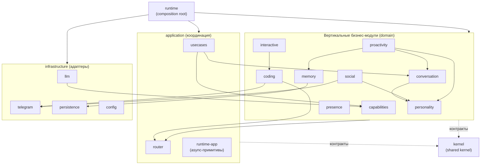

<!-- Copyright (c) 2026 Vladimir Zoologov. All Rights Reserved.
     SPDX-License-Identifier: BUSL-1.1 -->

# Архитектура Боба

> **Навигационный обзор.** Этот документ — карта системы: слои, доменные модули,
> граф зависимостей и сквозной поток обработки сообщения. Подробности по каждому
> модулю живут в отдельных SPEC (`domains/<module>/README.md`,
> `services/runtime.md`) — ссылки в таблице ниже. Первый запуск —
> [`getting-started.md`](getting-started.md).

Боб — это единый Python-процесс, который держит **два aiogram-бота** (Боб и
GUPPI), локальный и облачный LLM за провайдер-агностичным роутером, память на
SQLite и ядро личности (Higher Mind). Пользователь пишет в приватную
Telegram-supergroup: Боб живёт в своём форум-топике и отвечает «печатает…»-
индикатором и форматированным rich-сообщением — с учётом настроения, вкусов и
памяти — а GUPPI работает привратником и админом в General. Оба бота — админы
группы, поэтому групповое сообщение может прийти на обоих; их поллит один
`MultiBotGateway`, дедуплицируя по `(chat_id, message_id)`. Система переживает
рестарты процесса и машины. Доступ закрыт авторизацией (owner + allowlist + scope
по чату), отказ неавторизованному **виден**, петля устойчива к транзиентным
сетевым сбоям, а навыки Боба исполняются через стабильный Capability-шов. На
каждый входящий Боб **понимает сообщение в контексте** и выбирает — как человек —
ответить словами, поставить эмодзи-реакцию или промолчать (семантическое
суждение, BOB-049). А если связь с моделью рвётся на существенном шаге — это
**полный Боб или честный GUPPI-нотис**, а не деградированный полуответ. Боб не
только реактивен: проактивный drive-движок (BOB-010) иногда пишет первым по
«порыву» из внутреннего состояния, под governance-потолками и owner-командами
`/quiet`/`/wake`.

## Слои (DDD + гексагональная архитектура)

Зависимости направлены только внутрь: `runtime → infrastructure → application →
domain`. Домен не импортирует ничего наружу; приложение зависит от домена через
порты-протоколы и не импортирует инфраструктуру; композиция живёт только в пакете
`src/bob/runtime/` (composition root; `app.py` — тонкий re-export shim над ним).

```
src/bob/
  kernel/            # 🔴 SHARED KERNEL (BOB-062.8): инфра-нейтральные кросс-модульные
                     #   контракты — Clock, DomainEvent, EventBus, EventHandler,
                     #   JsonValue, LLMMessage, LLMProvider; с BOB-113 ещё события
                     #   интейка, порты памяти/ответа/tool-calling, RuleModulators и
                     #   социальный словарь (Interlocutor/Trust/Gender, Relationship,
                     #   RosterMember, SulkState; поведение — в social; инварианты значений
                     #   — в функциях модульного уровня, под мутацией); с BOB-116 — здоровье
                     #   LLM-провайдеров (provider_health + порты HealthObserver/HealthReader/
                     #   OwnerAlertSink/SelfReportingProvider), время и русские слова для
                     #   человека (local_time, ru_text). Чистый inward-safe leaf
                     #   (только stdlib/typing); любой модуль может импортить,
                     #   kernel НЕ импортит модули (правила kernel-no-*).
  <module>/          # 8 ВЕРТИКАЛЬНЫХ бизнес-модулей (domain-first, BOB-062): coding,
                     #   interactive (живой терминал, отделён от coding в BOB-087.E),
                     #   memory, proactivity, capabilities, social, personality,
                     #   conversation. Каждый собирает СВОИ три слоя внутри одного
                     #   bounded-context — ports.py + логика (layer=domain), usecases/
                     #   (layer=application), adapters/ (layer=infrastructure) — и несёт
                     #   не-слойный тег module-vertical. Границы держат explicit-path
                     #   forbid_import-правила, СГЕНЕРИРОВАННЫЕ scripts/gen_boundary_rules.py.
  application/       # Тонкий слой кросс-доменных оркестраторов (нужны несколько
                     #   bounded-context'ов): usecases/ (HandleMessage-оркестратор +
                     #   EssentialRunner/PreComposeGate/privileged_fulfiller/perceive_reaction),
                     #   router/ (LLMRouter: задача → Tier + правило редакции; монитор
                     #   здоровья провайдеров и тексты владельцу, BOB-116),
                     #   runtime/ (async-примитивы: AgentRuntime, AsyncEventBus, periodic, retry +
                     #   intake/ — concurrency-шов между поллером и Бобом: ChatDispatcher/
                     #   ChatInbox/TurnScope, BOB-066).
  infrastructure/    # Адаптеры общих компонентов: telegram/ (MultiBotGateway + GUPPI +
                     #   aiogram; сигнал владельцу в личку и снимок здоровья для /status,
                     #   BOB-116), llm/ (OpenAICompatProvider + фабрика + аварийный
                     #   фолбэк Tier 0 на локальную модель, по умолчанию выключен; доклад
                     #   здоровья обёрткой Tier-1 и композитом дублёра, BOB-116),
                     #   persistence/ (connection-kernel SqliteConnection + schema.sql),
                     #   config/ (ConfigLoader).
  runtime/           # composition root + entrypoint (единственный слой, зовущий все
                     #   слои и все модули; модули НЕ импортят runtime). Отличать от
                     #   application/runtime/ (async-примитивы, НЕ composition root).
  app.py             # тонкий re-export shim над runtime (launcher ./bob + тесты держатся)
```

> **BOB-062 (domain-first реорг, завершена).** Прежний layer-first пакет
> `src/bob/domain/` **удалён**: чистая логика разъехалась по domain-слоям семи
> вертикальных модулей, а инфра-нейтральные кросс-модульные контракты собраны в
> `src/bob/kernel/`. Транзитный ports-шим (`domain/ports/`) удалён; импорты
> ходят на канон — `bob.<module>.ports` (модульные порты) и `bob.kernel.ports`
> (kernel-контракты).

Граница слоёв — не только соглашение: `tests/application/test_layering.py`
сканирует каждый файл слоя `application` и падает на любом импорте
`bob.infrastructure`. Границы вертикальных модулей держат `forbid_import`-правила
в `.beadloom/_graph/rules.yml`; их **генерирует** `scripts/gen_boundary_rules.py`
из `module-vertical`-узлов графа (explicit paths, не char-class'ы), режим
`--check` — CI-gate идемпотентности. На каждый модуль генерируются
`usecases-no-adapters`, `internals-no-usecases`, `internals-no-adapters`,
`usecases-no-infra`, `no-composition-root` + inward-границы от чужих модулей;
координационные слои (`application` / `infrastructure` / `runtime`) из
inward-модели исключены намеренно — они по определению собирают и зовут
usecases/adapters модулей.

## Доменные модули и сервисы

Каждый модуль — bounded-context со своим SPEC. За полными инвариантами, API и
тестами — переходите по ссылке.

| Модуль | Слой / вид | Что делает | SPEC |
|---|---|---|---|
| **coding** | вертикальный (business) | «Боб пишет код» — ГЕЙТОВАННЫЙ автономный кодинг через `claude` CLI, план→апрув→worktree→PR; лайв-стрим в личку owner'а (dev-канал, `coder.dev_dm`, BOB-082); owner-ослабления песочницы (`coder.allow_bypass` / `coder.extra_dirs`, оба OFF) + push-барьер. Здесь же ОБЩАЯ поверхность coding-сессии, на которую опирается `interactive`: порты, `CodingSession`/`CodingOutcome`, машина состояний, имена веток, политика песочницы, `push_guard`, `stream_json`; канон «кто озвучивает сообщение» — `speaker`/`channel_for` (механика — GUPPI, живое и запрос разрешения — Боб, BOB-090.D) | [`domains/coding/README.md`](domains/coding/README.md) |
| **interactive** | вертикальный (business) | «Боб держит живой терминал» — двусторонний сеанс `claude` с открытым stdin в личке owner'а (`coder.interactive`, BOB-083); долгоживущее рабочее место `/workspace` + возобновление `/resume` с подтверждением и TTL (`coder.resume`, BOB-087.D); одна сессия за раз, никакого live-attach, PR-открывашки нет вовсе. Отделён от `coding` в BOB-087.E; ребро `interactive → coding` одностороннее | [`domains/interactive/README.md`](domains/interactive/README.md) |
| **memory** | вертикальный (business) | «Боб помнит» — эпизоды + семантические факты, гибридный recall (FTS5 + sqlite-vec → RRF), scope-провенанс `visibility` (`NULL`=public, BOB-066), точный адрес источника `origin_chat_id`/`origin_topic_id` (`NULL`=«не знаю», BOB-090.C2), автобиография `self_action` от первого лица (BOB-079) | [`domains/memory/README.md`](domains/memory/README.md) |
| **personality** | вертикальный (business) | «кто Боб есть» — mood/disposition/taste/negotiation/voice/reflection/soul; второй слой `room_tone` (настроение комнаты красит голос и аппетит поверх личного mood, BOB-066) | [`domains/personality/README.md`](domains/personality/README.md) |
| **conversation** | вертикальный (business) | «как ведётся ход» — адресность, conversational floor, brevity, engagement, судьи отклика, рефлексивное «чтение комнаты» (двускоростное внимание, за флагом `presence.reflective`) | [`domains/conversation/README.md`](domains/conversation/README.md) |
| **social** | вертикальный (business) | «Боб различает людей» — идентичность, первое впечатление, отношения, per-person обида/охлаждение (таблица `person_sulk`, адресный холод), такт разглашения (`disclosure` — гость не видит owner_private инициативно; scope по МЕСТУ + раскрытие приватного по согласию owner'а, BOB-082), кредит доверия (`endorsement`/`endorsed_seed` — owner ручается за новичка), ростер комнаты (`roster` — припоминание состава по социальному поводу, BOB-080), адресация и упоминания (`destination` — куда именно писать, при неоднозначности переспросить; `mention` — настоящий `@ник` или имя, никогда выдуманный тег; перенос приватного в публичный чат по МАТЕРИАЛУ и по согласию owner'а, BOB-090.B), авторизация, permission, genesis | [`domains/social/README.md`](domains/social/README.md) |
| **proactivity** | вертикальный (business) | «фоновая жизнь Боба» — drive-движок, свои цели (Goal Engine), само-улучшение | [`domains/proactivity/README.md`](domains/proactivity/README.md) |
| **presence** | вертикальный (business) | «живой ритм Боба» — доля эфира (soft-ceiling с focus-bypass), естественная задержка ответа, бюджет реакций, гейт устаревания черновика (`StalenessGate`: SEND/REWRITE/DROP_TO_LIKE/MERGE, B2=B7), догоняющий проход по бэклогу (`select_catchup`: банд-скоринг direct>reply-thread>ambient, фокус небюджетно гарантирован, INV-10); потребление вшито в горячий путь через коллабораторов за флагами `presence.rhythm` / `presence.staleness` / `presence.catchup` / `presence.series_budget` (все OFF по умолчанию → продакшн байт-в-байт) | [`domains/presence/README.md`](domains/presence/README.md) |
| **capabilities** | вертикальный (business) | «инструменты Боба» — registry + tool-loop + навыки (recall, web_search, read_url, диаграммы, интроспекция, dev-интроспекция git/трекер read-only BOB-081, весь read-only beadloom — схема + влияние + состояние проекта, BOB-091 за флагом `introspection.architecture_tools` OFF, отправка в указанный чат `send_to_chat` за флагом `social.delivery` OFF, BOB-090.B) | [`domains/capabilities/README.md`](domains/capabilities/README.md) |
| **application** | координационный слой | тонкие кросс-доменные оркестраторы (HandleMessage), LLM-роутер, async-примитивы рантайма | [`domains/application/README.md`](domains/application/README.md) |
| **infrastructure** | координационный слой | адаптеры: Telegram (aiogram + мульти-бот), LLM-провайдеры, SQLite-connection-kernel, конфигурация | [`domains/infrastructure/README.md`](domains/infrastructure/README.md) |
| **domain (layer)** | чистое ядро | обзор чистого ядра — kernel-контракты + domain-слои вертикальных модулей | [`domains/domain/README.md`](domains/domain/README.md) |
| **runtime** | сервис | composition root + entrypoint — сборка адаптеров, подписки, poll-таск, heartbeat-тики, Genesis | [`services/runtime.md`](services/runtime.md) |

## Граф зависимостей

Диаграмма — модули (feature/component-узлы) сгруппированы по слоям, `runtime` —
composition root над всеми. Источник — `beadloom graph` (`.beadloom/_graph/`);
здесь курированный срез без служебных `part_of`/`touches_code`-рёбер.



### Порядок вертикалей и правило размещения контракта (BOB-113)

🔴 **Инвариант: runtime-порядок вертикалей.** Модули, которые раньше замыкали общий цикл,
выстроены в одну цепочку. Стрелка означает «зависит от»: каждый модуль импортирует только
модули правее себя и `kernel`, который лежит ниже всех.

```
usecases → capabilities → social → telegram → proactivity → memory → runtime-app → conversation → personality
```

Порядок выведен из runtime-рёбер (импортов модульного и функционального уровня), а не
назначен. Если граф изменится, гард ниже назовёт ребро, которое порядок нарушило.

**Правило размещения.** Сигнатуры модуля называют типы только модулей ниже него или
`kernel`. Отсюда место для каждого нового имени, в порядке предпочтения:

1. Собственное понятие модуля живёт у владельца. Модули выше импортируют его вниз
   (`PersonalityState` — `personality/state.py`, `EngagementState` —
   `conversation/engagement.py`).
2. Порт, который описывает чтение одного контекста, живёт в `ports.py` этого контекста
   (социальные читатели хода — `social/ports.py`, `CurrentFascinationReader` —
   `personality/ports.py`).
3. Значение или порт, который нужен модулю ниже владельца, уходит в shared kernel (события
   интейка, `Recalled`, порты памяти и ответа, словарь tool-calling'а, `RuleModulators`,
   социальный словарь). Поведение остаётся у владельца.
4. Коллаборатору, у которого потребитель читает одно поле или метод, достаточно узкого
   Protocol у самого потребителя (ISP): `conversation.ports.VerifySearch` / `HasAnswer`
   вместо порта веб-поиска `capabilities`.

Ре-экспортов по старым путям нет: у каждого имени один дом. До BOB-113 type-only импорты
(под `if TYPE_CHECKING:`) замыкали один цикл из девяти модулей. После переезда контрактов
(29 имён по 22 решениям RFC) `beadloom lint --strict` не находит ни одного цикла, а из 81
ребра `depends_on` type-only остались 8, и все они направлены вниз или в ядро.

**Кто это держит.** Четыре независимые проверки:

- `no-dependency-cycles` в `.beadloom/_graph/rules.yml` — `severity: error`, без исключений.
  Beadloom читает и импорты под `TYPE_CHECKING`, поэтому type-only ребро вверх по порядку
  возвращает цикл.
- `tests/test_no_runtime_import_cycles.py` — гард, который не зависит от beadloom:
  - `test_runtime_imports_form_no_cycle_between_modules` — исполняемые импорты (без ветки
    `TYPE_CHECKING`) не образуют цикла между модулями;
  - `test_runtime_edges_follow_the_declared_vertical_order` — ни одно runtime-ребро не идёт
    вверх по порядку (константа `_VERTICAL_ORDER` в тесте);
  - `test_no_type_checking_import_points_upward_against_the_vertical_order` — ни один
    `TYPE_CHECKING`-импорт не направлен вверх, а любое ребро ИЗ `kernel` считается
    направленным вверх.

  Охват гарда направления — только девять узлов `_VERTICAL_ORDER` (в их числе
  `infrastructure.telegram`) и `kernel`. Узлы вне порядка (`coding`, `interactive`, `identity`,
  `presence`, `router`, `runtime`/`wiring`, `llm`, `persistence`, `config`) гардом направления
  не судятся: их границы держат
  `forbid_import`-правила из `rules.yml` (и только те строки индекса, которые beadloom видит —
  см. паритетный тест ниже) и правило `architecture-layers`, которое судит 15 из 81 ребра
  `depends_on` (остальные 66 — рёбра вертикалей, вне слоёв по замыслу BOB-062.6a).

  Оба сборщика импортов читают все формы импорта: `import bob.x`, `import bob.x.y as z`,
  `from bob.x import y`, `from bob import x`, `from bob.application import usecases` и
  относительные импорты. Выход относительного импорта за пределы пакета — явная ошибка, а
  не пропуск. Символ, чьё имя отличается от файла модуля только регистром, остаётся символом
  и на файловой системе без учёта регистра.
- `tests/test_beadloom_sees_every_import.py` — сверяет импорты, которые прочитал `ast`, с
  индексом beadloom (`code_imports`). Тест пересобирает индекс бинарём `beadloom` с PATH в
  копии `src` и `.beadloom`. Если бинаря на PATH нет, тест даёт SKIP с причиной «НЕ
  проверялось». Правила `forbid_import` судят только строки этого индекса, поэтому импорт без
  строки не судит ни одно правило. Замер саботажем на `beadloom==9.0.0` (правило
  `memory-boundary-no-coding-adapters`, файл `coding/naming.py`): закреплённая сборка не
  видит четыре формы, и `lint --strict` на каждой из них даёт exit 0.
  - `import bob.memory.adapters.fts_recall as _f` — строки в индексе нет. Та же строка без
    `as` даёт exit 1.
  - `from ..memory.adapters import fts_recall` — относительный импорт, строки нет.
  - `from bob import memory` — в индексе записано `bob`.
  - `from bob.memory import adapters` — в индексе записан пакет `bob.memory`, а не
    подмодуль, поэтому glob `bob/memory/adapters*` его не находит.

  Последняя форма так же слепа внутри своего узла: `from bob.coding import usecases` в
  `coding/naming.py` записан как `bob.coding`, и правило `coding-internals-no-usecases` не
  видит, что доменный модуль берёт use-case своей вертикали (lint exit 0, замер ревью .9).
  Так обходятся все правила вида `*-internals-no-usecases`, `*-internals-no-adapters` и
  `*-usecases-no-adapters` — 38 из 262 правил `forbid_import` (замер 2026-10-21).

  Тест требует строку с полным модулем для каждого связывания — и в другой узел, и внутри
  своего, поэтому все четыре формы на нём краснеют в любом месте. Зона закрыта в bob-7fo.10:
  две инструкции этой формы в `src` (`coding/usecases/coding_assistant.py` и
  `interactive/usecases/session.py`, три связывания) переписаны в
  `from bob.<узел>.<модуль> import <имя>`, и после этого lint на чистом индексе находит 0
  ошибок. Исправление самого резолвера beadloom остаётся записью в
  `features/BOB-112/BDL-UX-draft.md`.
- `tests/domain/kernel/test_kernel_isolation.py` — импорт каждого модуля ядра в
  изолированном интерпретаторе не загружает ни одного `bob.*` вне `bob.kernel`.

🔴 **Слепая зона правила циклов (наблюдение O1 ревью BOB-113).** `no-dependency-cycles` не
видит рёбер ИЗ ядра: узлы `kernel` и `bob-domain` делят `source: src/bob/kernel/`, импорты
резолвятся в `bob-domain`, и ребро `kernel → <модуль>` не порождает derived-ребра. Саботаж
`kernel → memory` правило циклов не заметило. Направление ядра держат правила `kernel-no-*`
(beadloom), тест изоляции и `tests/test_no_runtime_import_cycles.py` — все три на этом
саботаже покраснели. Ядро теперь держит события интейка, порты и социальный словарь, поэтому
полагаться здесь на правило циклов нельзя.

## Сквозной поток: обработка сообщения (perceive → decide → act → persist)

Когда пользователь пишет в Telegram, Боб проживает один ход. Поток собирается в
`HandleMessage` (`application/usecases/handle_message.py`). Подписчик `MessageReceived` в
`AsyncEventBus` — уже не сам `HandleMessage`, а быстрый `ChatDispatcher.submit`
(intake-развязка, BOB-066 Срез 2.1, см. ниже); per-`chat_id` воркер зовёт
`HandleMessage.handle(event, scope)` с per-turn `TurnScope`.

`handle_message.py` — **тонкий оркестратор, а не God-use-case** (BOB-062.6b, #9):
`HandleMessage.handle(event, scope=None)` проводит ход по фазам **perceive → who → gate →
compose+guard → post-effects**, делегируя каждую ~14 когезивным коллабораторам,
разложенным по чистым модулям. `HandleMessage.__init__` остаётся композиционным
корнем (собирает коллабораторов из инъектированных швов). Контракты этих швов живут у
владельцев, а не в оркестраторе (BOB-113): социальные читатели — `social/ports.py`,
`CurrentFascinationReader` — `personality/ports.py`, держатели `PersonalityState` —
`personality/state.py` и `EngagementState` — `conversation/engagement.py`; общие порты
(`ReplyGateway`, `EpisodeReader`, `MemoryRecall` …) — в `kernel/ports.py`. Карта
коллаборатор → модуль:

| Коллаборатор | Модуль | Роль |
|---|---|---|
| `MoodPerceiver` | `personality/usecases/mood_perceiver.py` | обновить настроение из входящего + план выражения (BOB-018) |
| `GroundedAddons` | `personality/usecases/grounded_addons.py` | заземлённые добавки (рефлексия/колбэк/фасцинация), decorative |
| `VoiceComposer` | `personality/usecases/voice_composer.py` | голос + генерация ответа |
| `SocialContext` | `social/usecases/social_context.py` | per-person чтение: отправитель, первое впечатление, отношение, обида, стойка, тон |
| `AddressivityPerceiver` | `conversation/usecases/addressivity_perceiver.py` | восприятие адресности + брать ли ход |
| `EngagementModel` | `conversation/usecases/engagement_model.py` | аппетит + verbosity + after-turn feedback |
| `RecallAssembler` | `conversation/usecases/recall_assembler.py` | воспроизведение треда + absence/acknowledgment |
| `FloorManager` | `conversation/usecases/floor_manager.py` | resolve + advance разговорной реплики (floor) |
| `VerifyStep` | `conversation/usecases/verify_step.py` | предответная эпистемическая проверка → per-turn note |
| `TurnGate` | `conversation/usecases/turn_gate.py` | гейт хода: reply/react/silent + фокус/периферия-развилка (BOB-066 Срез 2.2, INV-1) |
| `ReadTheRoom` | `conversation/usecases/read_the_room.py` | рефлексивное «чтение комнаты» на периферийном ходе (BOB-066 Срез 2.2, за флагом `presence.reflective`) |
| `BatchRoomReader` / `decide_batch` | `conversation/room_reading.py`, `conversation/room_verdict.py`, `conversation/adapters/room_reader.py` | холистический stream-read ПАЧКИ ambient (BOB-072): один Tier-1 read по всей осевшей вспышке → `BatchRoomReading` (per-message reply/react/ignore, толерантный all-IGNORE) → чистое `decide_batch` (проекция read→verdict). Компонент за флагом `presence.stream_read` (`runtime/wiring/stream_read.py`, bare bool, OFF) |
| `RoomStreamReader` (врезка) | `application/runtime/intake/room_stream_reader.py`, `application/runtime/intake/dispatcher.py`, `conversation/usecases/turn_gate.py` | врезка stream-read в `_handle_batch` (BOB-072 бид .2): осевшая пачка SPLIT на focal (прямое обращение → детерминированно как сейчас, INV-1) и ambient (весь остаток → ОДИН `RoomStreamReader.read` → per-message `RoomReading` едет на `TurnScope.ambient_reading`); `TurnGate` применяет её напрямую (минуя per-message read) — reply/react по решению + персист/floor для ВСЕХ включая IGNORE (INV-S2, Seam B). Fallback all-IGNORE. Заменяет скриптованный top-k, когда флаг ON; OFF → прежний путь |
| `AntiRepeatGuard` | `conversation/usecases/anti_repeat_guard.py` | анти-повтор/тик + кольцо закрывающих |
| `EssentialRunner` | `application/usecases/essential_runner.py` | ретрай существенных LLM-шагов + честный GUPPI-нотис |
| `PreComposeGate` | `application/usecases/precompose_gate.py` | coding-intent + permission гейты, что могут забрать ход |
| `DiagramSender` | `capabilities/usecases/diagram_sender.py` | авто-рендер inline-mermaid + отправка диаграмм |
| `StalenessReassessor` | `application/runtime/staleness_reassessor.py` | переоценка черновика под сместившимся контекстом (BOB-066 Срез 3.1): `scope.peek_arrivals`-пачка → `StalenessGate` → SEND/REWRITE/DROP_TO_LIKE/MERGE; врезан в `handle` (`_drop_to_like_if_stale`) за флагом `presence.staleness.enabled` (OFF → врезка не строится) |
| `CatchUp` / `CatchUpReentry` | `application/usecases/catch_up.py`, `application/runtime/catch_up_reentry.py` | один догоняющий проход по бэклогу отсутствия (BOB-066 Срез 3.2): `peek_since`-снимок → `select_catchup` под бюджетом (фокус небюджетно гарантирован, INV-10) + тон входа `absence_hint`; врезан в per-chat воркер `ChatDispatcher` за флагом `presence.catchup.enabled` (OFF → как раньше) |
| `EndorsementSeeder` | `application/usecases/endorsement_seeder.py` | кредит доверия (BOB-066 W.4): после реплея истории пере-биндит отношение тёплым `endorsed_seed`, если owner ручался за новичка в общем треде; врезан в `_prepare_eq_live` за флагом `presence.endorsement.enabled` (OFF → отношение без изменений) |
| `DisclosureGuard` | `application/usecases/disclosure_guard.py` | такт разглашения (BOB-066 W.4): переиспользует порт `PrivilegeJudge`, гостю на `owner_data`-запрос выдаёт `tactful_withhold_directive` (тёплый отказ) в compose+guard; врезан в `_prepare_eq_live` за флагом `presence.tact.enabled` (OFF → `withhold_directive` пуст) |
| `RoomMoodModulator` | `application/usecases/room_mood_modulator.py` | настроение комнаты в тоне (BOB-066 W.2): из рефлексивного `RoomReading` (surfaced на `_ReplyGate`) по значению даёт `room_tone` голосу и re-map порога аппетита; врезан в `_apply_room_mood` за флагом `presence.room_mood.enabled` (OFF → тон пуст, уровень как был) |
| `DeliveryScope` / `TurnMaterial` | `capabilities/usecases/delivery_scope.py`, `capabilities/usecases/turn_material.py` | адресация вовне (BOB-090.B): след материала хода армируется на ВЕСЬ `handle`, снимок обстоятельств — вокруг генерации; их читает `send_to_chat` за флагом `social.delivery` (OFF → навык не зарегистрирован, снимок читать некому). Нет армированного хода — нет отправки |

🔴 **Цикл compose↔guard замкнут колбэком по значению, а не импортом.**
`AntiRepeatGuard` (conversation) принимает `VoiceComposer.compose` (personality)
как callback, так что регенерация повтора вызывает композицию БЕЗ импорта
`conversation → personality`. 🔴 **Turn-local state — через аргументы, никогда не
атрибут** коллаборатора (класс — shared singleton): `verify_note`, `closer_nudge`,
`recalled`, `is_guest`, `reply`, `chat_id`, announcer прокидываются параметрами и
через тот же callback, поэтому не протекают между ходами и пользователями. 🔴 Сюда же
относится **seeded-rng хода**: `handle(event, scope)` берёт `scope.rng` (per-turn поток,
засеянный координатами `(base, chat_id, message_id)`) и прокидывает его во ВСЕ
seeded-draw-сайты хода (plan → engagement → verbosity → addressivity → surface/ack →
compose/guard), так что конкурентные чаты никогда не делят поток розыгрышей (INV-4). При
прямом вызове без scope — откат на инъектированный per-boot rng (legacy-поведение
идентично).

Фазы хода:

1. **Приём (мульти-бот роутер + единый гейт авторизации).** `MultiBotGateway`
   (infrastructure/telegram) одним проходом поллит обоих ботов **изолированно**
   (обрыв long-poll — `TelegramNetworkError` и др. — не роняет тик; приём
   at-least-once: offset сдвигается только после успешной обработки, poison-cap
   от зацикливания — BOB-070), дедуплицирует
   кросс-бот по `(chat_id, message_id)`, затем центральный роутер проверяет
   topic-scope Боба и **единый гейт** `Authorizer` (social). Апдейт вне топика или
   из неразрешённого чата в пайплайн не попадает. В топике Боба ход публикуется и
   для авторизованного, и для гостя (BOB-019, ограниченный гостевой режим);
   owner-команда в General уходит GUPPI. Текстовый апдейт нормализуется в
   `MessageReceived` и публикуется в `AsyncEventBus`. **Подписчик события — быстрый,
   неблокирующий `ChatDispatcher.submit`** (intake-развязка, BOB-066 Срез 2.1): он
   буферизует сообщение и мгновенно возвращается, поэтому поллер Telegram больше НЕ ждёт
   генерацию Боба; per-`chat_id` воркер за швом дренирует буфер и зовёт `HandleMessage`
   последовательно (см. «Intake-развязка» ниже). → см.
   [social](domains/social/README.md), [infrastructure](domains/infrastructure/README.md).
2. **Perceive (обновление настроения, Tier 0).** `UpdateMoodFromText`
   (personality) читает сигналы — сентимент (Tier 0, локально), частоту, время
   суток, присутствие — и собирает `MoodDelta`. Шаг сентимент→валентность
   асимметричен (диспозиция, BOB-033), а позитивный входящий сначала тянет
   настроение к baseline — главный анти-депрессант. Сентимент — необязательный шаг хода:
   он идёт через `LLMRouter.run_optional`, и при недоступном провайдере настроение остаётся
   прежним, а ход доходит до голосовой двери (BOB-116 D13). → см.
   [personality](domains/personality/README.md).
3. **Гейт хода: семантическое решение об отклике (BOB-049).** `_gate_turn` решает,
   **берёт ли Боб ход и как** (`REPLY`/`REACT`/`IGNORE`): `DecideResponse`
   (conversation) взвешивает по смыслу контекст хода — текст, отправитель (social),
   общий недавний тред топика (BOB-058), структурные подсказки (mentions/reply-to/
   адресность/floor), тон настроения. Без судьи — легаси-лестница адресности
   (BOB-023, BOB-025). → см. [conversation](domains/conversation/README.md).
4. **Decide (план выражения + recall + история + личность).** `REPLY` идёт в
   компоновку (ветки `REACT`/`IGNORE` завершаются внутри `TurnGate`, обе персистят
   ход, BOB-045). План выражения (BOB-018, seeded-RNG) выбирает grounded-добавки;
   воспроизводится общий тред топика (BOB-058), извлекаются факты (`MemoryRecall`,
   FTS5, единый recall на группу, BOB-051), собирается контекст ответа (идентичность,
   тон, вердикт `TasteEngine`, фантомы, факты). Recall фильтруется тактом разглашения
   (`_recall_surfaceable` → `filter_surfaceable`, BOB-066): гостю не всплывает
   `owner_private`-память ни на FTS5-, ни на векторном пути; для owner/known-peer
   (TRUSTED) — no-op, recall байт-в-байт. Negotiation-врезка (BOB-013) даёт
   директиву стойки; краткость (BOB-024) выбирает `Verbosity`. → см.
   [memory](domains/memory/README.md), [personality](domains/personality/README.md),
   [conversation](domains/conversation/README.md).
5. **Act (ответ, гибридный тиринг + селективная редакция).** `LLMRouter`
   (application/router) обрабатывает `REPLY_TO_USER`. Тир выбирается гибридно
   (BOB-006): casual → быстрый **Tier 0**, сложное/длинное/с инструментами →
   качественный **Tier 1**. `shareable_context` сопровождает вызов (память Боба);
   `private_context` **редактируется** перед любым Tier 1 (привязка к политике
   задачи, не к тиру). При сбое Tier 1 (авария связи, а с BOB-116 и 401/403) — откат на
   Tier 0, но ход, чей голос
   ОСТАЁТСЯ, получает Tier-0 без аварийного локального дублёра (BOB-087.E-M1,
   BOB-096.4). Генерация — существенный шаг (ретрай → честный GUPPI-нотис при
   провале). Запрет отыгрывать GUPPI при этом доезжает не только сюда: он
   вплетается в payload на обеих точках выхода к модели через порт провайдера —
   в роутере и в петле инструментов (BOB-096), поэтому его видят и двери, пишущие
   в память. → см. [application](domains/application/README.md).
6. **Ответ (typing-индикатор + rich-финал, BOB-009).** Стрима нет (групповой
   топик). Медленная генерация идёт внутри `typing_indicator(chat_id)` (keepalive
   каждые `typing_interval` с), готовый ответ коммитится одним `reply()` — Rich
   Message'ом, привязанным к `message_thread_id`; при любой ошибке rich — деградация
   на plain. → см. [infrastructure](domains/infrastructure/README.md).
7. **Persist.** Ход сохраняется как эпизод в `episodic_log` (атрибутирован
   `sender_id`, BOB-045), снапшот настроения — в `mood_state`/`mood_history`.
   Персист идёт во **всех** ветках (`REPLY`/`REACT`/`IGNORE`/сбой). Новые эпизоды и
   факты штампуются scope-провенансом `visibility` (`_turn_visibility`: owner-DM →
   `owner_private`, чужой ход → `public`, BOB-066; `NULL`=public для legacy) и точным
   адресом хода `origin_chat_id`/`origin_topic_id` (BOB-090.C2; `NULL` здесь — «источник
   неизвестен», а не «публично»). Извлечение
   фактов (`extract_facts`) — для любого участника закрытой группы (BOB-051). → см.
   [memory](domains/memory/README.md).

Параллельно идёт лёгкий **heartbeat** — фоновые asyncio-задачи рантайма, каждая
изолирована: ошибка в одном тике не роняет остальные, транзиентный сбой ретраится
с backoff. Дорожки, которые думают Tier-0, стоят под гейтом здоровья LLM (ниже).
Подробнее о сборке и запуске — [`services/runtime.md`](services/runtime.md).

## Здоровье LLM-стека (BOB-116)

Отказ LLM-провайдера больше не беззвучен. В октябре 2026 Tier-0 десять дней отвечал 403, и об
этом не знал никто: 32 086 строк лога, ноль эпизодов, ноль сигналов (Issues #64). Теперь у
каждого провайдера есть состояние, переходы которого видит владелец.

```
              исход каждого HTTP-вызова (успех / отказ + класс из classify_failure)
  LLMRouter._complete ────────┐     ┌──── FallbackLLMProvider (композит дублёра Tier-0)
  (голый Tier-0, голый Tier-1 │     │     tier0-primary и tier0-understudy по отдельности
   ручной сборки)             │     │  ┌── ReportingLLMProvider (обёртка Tier-1 из фабрики:
                              ▼     ▼  ▼     и роутер, и ToolLoop) — tier1
                    HealthObserver (порт, kernel/ports.py)
                              │
                 ProviderHealthMonitor (application/router/health_monitor.py)
                   состояние на провайдера = kernel/provider_health.py (чистое ядро)
                              │ переходы: DEGRADED · REMINDER · RECOVERED
         ┌────────────────────┼─────────────────────┬────────────────────────┐
         ▼                    ▼                     ▼                        ▼
  OwnerAlertSink         logger (1 строка     HealthReader              колбэк on_recovered
  (kernel/ports.py)       на переход)         → GUPPI /status           → эпизод «я молчал»
  → infrastructure/                           → гейт дорожек heartbeat    (OUTAGE_RECOVERED,
    telegram/owner_alert.py                     (TIER0_EFFECTIVE)          только после
    (бот Боба, личка owner_id,                → breaker композита          настоящей немоты)
     шаблон health_messages, без LLM)           дублёра
```

- **Кто докладывает.** Один HTTP-вызов — одна запись. Композит дублёра докладывает облако и
  дублёр отдельно: мёртвый ключ облака за живым дублёром иначе не увидит никто. Tier-1 фабрика
  оборачивает докладывающей обёрткой, потому что ход владельца идёт через `ToolLoop` прямо на
  Tier-1, мимо роутера (ревью M1). Роутер докладывает только провайдера, который не
  докладывает сам (`_reported_id`).
- **Класс отказа** — `auth` (401/403), `rate` (429), `server` (5xx/408), `timeout`,
  `connection`, `shape`, `contract` (`application/router/fallback_policy.classify_failure`).
  Дублёр — для всех классов, кроме `contract`; `retry.is_transient` не меняется (403 не
  ретраится).
- **Пороги** — блок `llm.health`: 5 отказов подряд или 180 с, напоминания 10 мин → 1 ч → 6 ч →
  сутки, зонд 1 → 2 → 5 мин.
- **Гейт дорожек.** `inner_monologue` — зонд; `reflect`, `proactive`, `pursue_goals` ждут
  молча; `poll` и `mood_drift` не гейтятся. Дорожка закрыта, только когда Tier-0 целиком не
  может думать: облако лежит И дублёра нет, он снят при старте или лежит тоже. Пока дублёр
  держит, дорожки идут, а в мёртвое облако между зондами не стучится композит (breaker).
- **Старт.** Дублёр, включённый в конфигурации, но без модели, снимается до перезапуска на
  роутере и в мониторе сразу, и владелец получает сообщение «стартовал без дублёра».
- **На VPS дублёр включён** (BOB-126, 2026-10-22): `qwen3.5:4b` на локальной Ollama рядом с
  `bge-m3`, обе модели держит в памяти drop-in `deploy/ollama-keep-alive.conf`, моделей не
  больше двух. Эксплуатация и выключение — `deploy/RUNBOOK.md` §11.
- **Медленный Tier-0 не держит поллинг** (BOB-126, ревью M1). Подписчик шины вызывается из
  цикла поллинга Telegram, а судья реакции — вызов Tier-0: на дублёре он может думать до
  180 с, и всё это время `get_updates` не уходил ни для одного бота. Подписчик
  `BOB_MESSAGE_REACTION` теперь только ставит реакцию в `SerialQueue`
  (`application/runtime/serial_queue.py`): один воркер, порядок поступления, вызывающий не
  ждёт. Сообщения так же идут через `ChatDispatcher.submit`.
- **Обращение и время.** Сигнал владельцу и сообщение «стартовал без дублёра» обращаются по
  `telegram.owner_address` («Вова»), а без него — по первому слову `telegram.owner_name`
  (`runtime/wiring/health.health_owner_address`, BOB-126). Время — в поясе процесса; на VPS
  его задаёт юнит `deploy/bob.service` (`TZ=Europe/Moscow`), поэтому тексты, `/status` и
  эпизод «я молчал» говорят `+03:00`.
- **Сервисная дверь хода не роняет ход** (D13): побочные шаги (настроение, пересмотр
  черновика) идут через `LLMRouter.run_optional` и при отказе доступности пропускаются.
- 🔴 **Чего монитор не покрывает.** Отказ самого Telegram: сигнал идёт через Telegram (PRD
  non-goal). Состояние живёт в памяти процесса: после рестарта монитор начинает со «здоров».
  Уведомление GUPPI о недоступности на ход в личке уходит в тему группы, а не в личку
  (`bob-hod`, Issues #71).

Подробности: [`router`](domains/application/features/router/SPEC.md),
[`llm`](domains/infrastructure/features/llm/SPEC.md),
[`kernel`](domains/domain/features/kernel/SPEC.md),
[`telegram`](domains/infrastructure/features/telegram/SPEC.md),
[`runtime`](services/runtime.md). Живая документация —
`tests/acceptance/features/llm_health.feature` (S1–S14) и сценарии S25/S26 в
`tests/acceptance/features/tier0_fallback.feature`.

## Intake-развязка: поллер ⇄ Боб (BOB-066 Срез 2.1)

Раньше поллер Telegram `await`-ил всю генерацию ответа прямо в своём цикле, поэтому
следующий `get_updates` не срабатывал, пока Боб «думал». Пакет
`application/runtime/intake/` разрывает этот шов, оставляя `AsyncEventBus`, gateway и
`poll_once` нетронутыми — быстрым стал только обработчик за швом. Подписчик
`MESSAGE_RECEIVED` теперь `ChatDispatcher.submit` (нормализовать → буфер → вернуться); за
ним один воркер на `chat_id` дренирует буфер чата и зовёт `HandleMessage.handle`
последовательно.

Модули пакета:

- **decisions.py** — чистое детерминированное ядро решений: `should_debounce`
  (замкнуть окно тишины в ноль при фокусе/закрытии), `batch_grew` (продолжать ли ждать
  всплеск), `derive_turn_seed` (сид турна из `(base, chat_id, message_id)`). Mutation-tested.
- **scope.py** — `TurnScope` (frozen-dataclass: `chat_id` / `message_id` / собственный
  `Random`) + фабрика `new_turn_scope`; изолированный per-turn контекст, прокинутый через ход.
- **inbox.py** — `ChatInbox`: per-`chat_id` буфер с debounce-окном. `offer` неблокирующий
  (append + wake); `drain_batch` ждёт короткое окно тишины «пусть допишут» и отдаёт
  осевший всплеск; снапшот+очистка синхронны (без `await` внутри), поэтому конкурентный
  `offer` не теряется. `peek_since` — недренажный снапшот для будущего catch-up (Фаза 3).
- **dispatcher.py** — `ChatDispatcher`: быстрый `submit` + по одному воркер-таску на
  `chat_id`. Каждое сообщение обрабатывается под свежим `TurnScope`; `wait_for_idle` — шов
  синхронизации для тестов (прод не зовёт); `aclose` — graceful-дренаж.
- **focus.py** — `make_focus_predicate` / `message_is_focused`: переиспользует ТОТ ЖЕ
  чистый детектор `classify_addressivity` (`DIRECTED_TO_BOB`), что и гейт адресности (DRY),
  так что «фокус» = @mention Боба / reply-на-Боба / «Боб, …». `bob_user_id` резолвится лениво.

Композиционный корень (`runtime/composition.py`) меняет подписчика с
`_as_handler(handle_message)` на `_as_dispatch_handler(intake_dispatcher)`; `Application`
получает поле `intake_dispatcher`, а `Application.shutdown` дренирует его дренажом
(`runtime.stop()` → `intake_dispatcher.aclose()` → `connection.close()`), поэтому корректная
остановка досдаёт буферизованные ответы и никогда не пишет сквозь закрытое соединение.
Окно debounce конфигурируется в `dialogue.intake_debounce_ms` (по умолчанию 0 — одиночные
ходы без задержки; богатое окно «пусть допишут» — opt-in). При `presence.stream_read` (BOB-072)
окно активируется (коалесинг вспышки в ОДИН холистический read; фокус всегда минует окно, INV-1);
при OFF окно = 0 → продакшн байт-в-байт.

Инварианты развязки:

- 🔴 **INV-5 (сериализация/порядок).** Один воркер владеет инбоксом чата, поэтому сообщения
  чата обрабатываются строго в порядке прихода (floor / mood / отношения продвигаются по
  порядку). Параллелизм — только МЕЖДУ чатами (разные воркеры); глобального лока нет, поэтому
  воркер может ждать только свой инбокс и не может задедлочить другой.
- 🔴 **INV-4 (turn-local изоляция).** Каждое сообщение обрабатывается под свежим `TurnScope`,
  чей `rng` засеян `(base, chat_id, message_id)` и прокинут в КАЖДЫЙ seeded-draw хода
  (включая регенерацию anti-repeat), поэтому конкурентные чаты не делят поток розыгрышей, а
  ход воспроизводим независимо от порядка диспетчеризации.
- 🔴 **INV-1/10 (фокус минует debounce).** Сообщение, прямо адресованное Бобу, замыкает
  окно тишины в ноль и флашится на уровне ВСЕГО батча (фокусное сообщение флашит растущий
  ambient-всплеск разом), поэтому фокус-сигнал никогда не теряется и не задерживается
  батчингом.

## Активация «человеческого группового присутствия» (BOB-066)

🔴 Весь слой группового присутствия отгружен **инертным за фичефлагами**: каждый
механизм собран, покрыт тестами и врезан в горячий путь через коллаборатора, но его
builder возвращает `None`/inert-bundle, пока флаг не включён. **Все флаги OFF по
умолчанию**, поэтому продакшн-путь ответа байт-в-байт равен пред-BOB-066 (это блокер
owner'а: команда добавляется в группу только когда весь эпик готов ЦЕЛИКОМ). Флаги
читаются в композиционном корне (`runtime/composition.py`) + builder'ах
`runtime/wiring/*.py`; отсутствующий ключ = выключено (`_flag` → `False`).

Owner включает поведение группового присутствия, добавив в конфиг (`config/bob.yaml`)
секцию `presence` и выставив нужные флаги `true` — для живой валидации ДО добавления
команды. Точные пути и формы:

| Флаг (точный путь) | Форма | Что включает |
|---|---|---|
| `presence.reflective` | 🔴 **голый bool** (НЕ `.enabled`) | рефлексивный «read-the-room» split — двускоростное внимание; строит `ReadTheRoom` и даёт `RoomReading` на периферийном ходе (BOB-066 Срез 2.2) |
| `presence.rhythm.enabled` | нест. `<section>.enabled` | ритм-слой: soft-ceiling доли эфира (barge/share) + человеческий пол задержки (`DelayedTurn`, INV-9); knobs `presence.rhythm.{share_min_multiplier,share_steepness,delay_base_seconds,delay_seconds_per_char,delay_complexity_seconds,delay_max_seconds,delay_urgency_relief,reaction_min_gap_seconds,reaction_quality_threshold,window_size}` (`window_size` по умолчанию 20) |
| `presence.room_mood.enabled` | нест. `<section>.enabled` | настроение комнаты красит тон голоса + re-map порога аппетита по значению из `RoomReading`; knobs `presence.room_mood.{heavy_valence,warm_valence,polarized}` |
| `presence.series_budget.enabled` | нест. `<section>.enabled` | batch top-k бюджет действий (один адресный ответ + ≤ N лайков на всплеск); knob `presence.series_budget.max_reactions` (по умолчанию 1) |
| `presence.stream_read` | 🔴 **голый bool** (НЕ `.enabled`) | холистический stream-read (BOB-072): осевшая ambient-пачка читается ОДНИМ Tier-1 read (`RoomStreamReader` → `TurnGate.ambient_reading`) вместо скриптованного top-k; персист/floor для ВСЕХ (INV-S2); focal минует batch (INV-1). Включает окно коалесинга `dialogue.intake_debounce_ms` |
| `presence.staleness.enabled` | нест. `<section>.enabled` | врезка переоценки черновика перед отправкой (`StalenessGate`: SEND/REWRITE/DROP_TO_LIKE/MERGE) над `scope.peek_arrivals` |
| `presence.catchup.enabled` | нест. `<section>.enabled` | догоняющий проход по бэклогу отсутствия в per-chat воркере; knobs `presence.catchup.{absence_hours,budget}` (по умолчанию 4.0 ч / 3) |
| `presence.endorsement.enabled` | нест. `<section>.enabled` | кредит доверия — warm-start новичка, за которого owner поручился в общем треде (требует `telegram.owner_id`) |
| `presence.tact.enabled` | нест. `<section>.enabled` | такт разглашения — тёплый отказ гостю на инициативный `owner_data`-запрос (голос, не гейт привилегий) |

🔴 **Несогласованность формы (осознанная, на заметку owner'у).** Мастер-гейт эпика
`presence.reflective` — **голый bool** прямо под `presence`
(`_flag(presence_section, "reflective")`), тогда как семь W-флагов следуют нестед-конвенции
`presence.<section>.enabled` (им нужны sub-knobs, а `_flag` не берёт dict). Ревью среза W
рекомендует выровнять на `presence.reflective.enabled` для единообразного «флипа эпика»;
пока — форма разная, и owner должен помнить: `reflective` пишется без `.enabled`.

🔴 **Зависимость.** `presence.room_mood.enabled` даёт эффект только при включённом
`presence.reflective`: тон комнаты берётся из `RoomReading`, который рождается лишь на
рефлексивном (периферийном) ходе. Без `reflective` `RoomReading` нет → модулятор
работает над пустым чтением. Для полного «живого Боба в группе» owner включает флаги
разом (интеграционный харнесс `tests/acceptance/wiring_integration_harness.py` гоняет
все восемь ON вместе и подтверждает INV-1: прямое обращение к Бобу отвечается даже при
рефлексивном IGNORE / исчерпанном потолке / активной обиде).

## Конфигурация, запуск и тесты

- **Первый запуск, конфигурация, env-переменные, лаунчер `./bob`** —
  [`getting-started.md`](getting-started.md).
- **Сборка приложения (composition root, порядок boot, heartbeat-тики)** —
  [`services/runtime.md`](services/runtime.md).
- **Тесты** лежат под `tests/`, повторяя структуру слоёв и модулей
  (`tests/domain/`, `tests/application/`, `tests/infrastructure/` + per-module
  наборы). Граница слоёв проверяется `tests/application/test_layering.py`,
  границы модулей — `beadloom lint --strict`; e2e — `tests/test_e2e_flow.py`,
  `tests/test_e2e_integration.py`. Инварианты и тестовые наборы каждого модуля —
  в его SPEC.
- **Пирамида качества.** Поверх модульных наборов — два верхних уровня.
  Приёмочные BDD-сценарии живут под `tests/acceptance/` (pytest-bdd,
  русскоязычный Gherkin): `.feature`-файлы описывают наблюдаемое поведение, а
  шаги проверяют его строго через границу `FakeGateway` (отправленные реплики,
  реакции, typing-индикаторы), не касаясь приватного состояния. Мутационное
  тестирование запускается адресно, по срезу, через `scripts/mutation.sh
  <module>` (mutmut мутирует только чистые доменные пакеты — технические слои
  и adapters/ports/`__init__` исключены; конвенция — ≥85% убитых мутантов на
  чистом домене с явной разметкой эквивалентных мутантов). Мутация в хуки и CI
  **не** входит — это осознанный ручной шаг. Порядок запуска, конфигурация и
  политика порога — в `.claude/dev-docs/MUTATION.md`.
