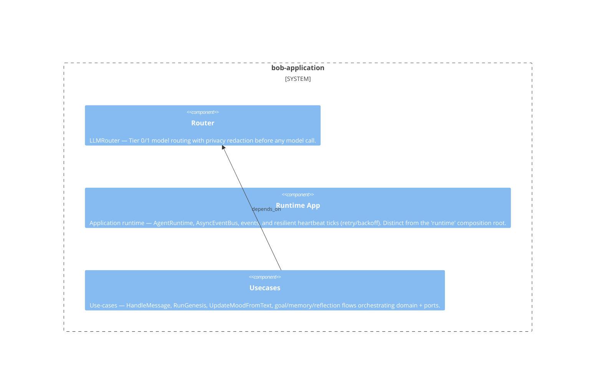

# bob-application

**Kind:** domain

GUPPI orchestration: AgentRuntime + AsyncEventBus, LLMRouter (tier routing + privacy redaction), use-cases (HandleMessage, RunGenesis, UpdateMoodFromText), resilient heartbeat ticks (retry/backoff), the Authorizer access policy and the capability seam (CapabilityRegistry + ToolLoop + recall_memory). Depends on domain via ports; never imports infrastructure.

**Source:** `src/bob/application/`

## Public symbols

- `AgentRuntime`
- `AmbientBatchReader`
- `AsyncEventBus`
- `BargeCeiling`
- `BobMessageLookup`
- `BobMessageReaction`
- `BobUserIdSource`
- `CatchUp`
- `CatchUpOutcome`
- `CatchUpReentry`
- `CatchUpSelection`
- `ChatDispatcher`
- `ChatInbox`
- `CurrentFascinationReader`
- `DelayedTurn`
- `DisclosureGuard`
- `EndorsementSeeder`
- `EngagementState`
- `EpisodeReader`
- `EpisodeWriter`
- `EssentialRunner`
- `FactDeduper`
- `FascinationEvolver`
- `FirstImpressionReader`
- `HandleMessage`
- `InnerMonologueTick`
- `InterlocutorResolver`
- `LLMRequest`
- `LLMRouter`
- `MemoryConsolidator`
- `MessageReceived`
- `MoodDriftTick`
- `NaturalCodingRouter`
- `OutageNotifier`
- `OwnerActivityRecorder`
- `PatternDetectorStep`
- `PerceiveReaction`
- `PermissionFlowLike`
- `PersonalityState`
- `PhantomEvolver`
- `PreComposeGate`
- `PrivilegedRequestFulfiller`
- `ReactionMemoryWriter`
- `ReactorResolver`
- `Reappraiser`
- `ReflectTick`
- `ReflectionContext`
- `RelationshipReader`
- `ReplyDelay`
- `ReplyGateway`
- `RetryPolicy`
- `RoomMoodModulator`
- `RoomStreamReader`
- `RuleAnnouncerStep`
- `RuntimeState`
- `SelfImprovementReader`
- `ShareOfVoiceGate`
- `StalenessReassessor`
- `SulkReader`
- `SulkRecoverer`
- `TaskType`
- `TasteProfileWriter`
- `TurnScope`
- `batch_grew`
- `call_with_retry`
- `derive_turn_seed`
- `is_transient`
- `make_focus_predicate`
- `message_is_focused`
- `new_turn_scope`
- `periodic`
- `reply_delay_inputs`
- `retry_with_backoff`
- `select_reply_tier`
- `should_debounce`
- `to_backlog_message`

## Relationships

- **part_of**: [bob](../services/bob.md)
- **depends_on**: [bob-domain](../domains/bob-domain.md)
- **Used by**: [bob-infrastructure](../domains/bob-infrastructure.md), [capabilities](../features/capabilities.md), [runtime](../services/runtime.md), [telegram](../other/telegram.md), [usecases](../features/usecases.md)
- **Parts**: [router](../features/router.md), [runtime-app](../features/runtime-app.md), [usecases](../features/usecases.md)

## Documentation

- [domains/application/README.md](/docs/domains/application/README.md)

## Diagram

