# bob-domain

**Kind:** domain

Domain layer umbrella: the seven module-vertical bounded contexts (personality, conversation, memory, proactivity, coding, capabilities, social) plus the shared `kernel` (infra-neutral cross-module contracts). Pure logic + Protocol definitions; no I/O, no LLM, no transport.

**Source:** `src/bob/kernel/`

## Public symbols

- `Clock`
- `DomainEvent`
- `EventBus`
- `LLMProvider`

## Relationships

- **part_of**: [bob](../services/bob.md)
- **Used by**: [bob-application](../domains/bob-application.md), [bob-infrastructure](../domains/bob-infrastructure.md), [runtime](../services/runtime.md)
- **Parts**: [capabilities](../features/capabilities.md), [coding](../features/coding.md), [conversation](../features/conversation.md), [kernel](../features/kernel.md), [memory](../features/memory.md), [personality](../features/personality.md), [presence](../features/presence.md), [proactivity](../features/proactivity.md), [social](../features/social.md)

## Documentation

- [domains/domain/README.md](/docs/domains/domain/README.md)

## Diagram

```mermaid
C4Container
    System_Boundary(bob_domain_boundary, "bob-domain") {
        Component(capabilities, "Capabilities", "", "Capabilities module («Bob's tools») — the full vertical GUPPI tool seam in one place: `ports.py` (Capability contract + tool/web/diagram/introspection ports) + pure `diagrams`/`introspection` value objects, `usecases/` (CapabilityRegistry + ToolLoop and the skills: recall/search memory, read code/url, web search, render diagram, inspect architecture, progress announcer), and `adapters/` (aiohttp URL reader behind an SSRF guard, mermaid renderer, beadloom/git introspector, Qwen web-search transport). Domain-first slice BOB-062.4.")
        Component(coding, "Coding", "", "Coding module («Bob writes code») — the full vertical capability in one place: `ports.py` + pure domain logic, `usecases/` orchestration, and `adapters/` (Claude Code CLI, git worktree, gh PR, session store, indicator). Domain-first slice BOB-062.1.")
        Component(conversation, "Conversation", "", "Conversation module («how a turn is conducted») — the full turn-conduct vertical in one place: `ports.py` (conversation-floor store, closer log, ZoneClassifier) + pure domain (addressivity, conversation + floor continuity, brevity, engagement, zone classifier, interim line, response choice, response/volatility judgments), `usecases/` (decide_response), and `adapters/` (Tier-0 response/volatility/interim judges + SQLite conversation-floor & closer-log stores). Depends on personality one-directionally. Domain-first slice BOB-062.6a.")
        Component(kernel, "Kernel", "", "Shared kernel — the infra-neutral contracts every vertical module rests on: the runtime seams (Clock, EventBus, EventHandler, DomainEvent, LLMProvider) and the shared value objects (LLMMessage, JsonValue). Pure Protocol/type definitions; no I/O. Every module may import from here; the kernel imports from no module.")
        Component(memory, "Memory", "", "Memory module («Bob remembers») — the full vertical capability in one place: `ports.py` + pure `entities`, `usecases/` (extract facts, consolidate, dedup), and `adapters/` (FTS5/hybrid recall + local Ollama embedder/reranker). Domain-first slice BOB-062.2.")
        Component(personality, "Personality", "", "Personality module («who Bob is») — the full character vertical in one place: `ports.py` + pure domain (Mood five-axis affect, TasteEngine + evolution, disposition, fascination + phantoms, language/profanity, expression incl. verbosity/engagement vocabulary, voice, the reaction family, negotiation stance, reflection, absence), `usecases/` (update mood from text, apply/reappraise/parse reflection, evolve fascination/phantoms), and `adapters/` (Tier-0 reaction judge + SQLite/kv fascination & notable-reaction stores). Domain-first slice BOB-062.6a. (Being-received reaction perception is a cross-domain use-case over mood + relationship, so it lives in `application/usecases/perceive_reaction`, not here.)")
        Component(presence, "Presence", "", "Presence module («Bob's living rhythm») — the ритм-слой of human group presence: `ports.py` + pure domain (OutgoingActivity rolling window, ShareOfVoicePolicy soft ambient ceiling with focus-bypass, NaturalDelayPolicy human reply floor, ReactionBudget gentle like budget, RhythmConfig tunables) + `adapters/` (episodic-log OutgoingActivityStore). Domain-first slice BOB-066.2.3; inert behind the `presence.rhythm` flag until the epic ships.")
        Component(proactivity, "Proactivity", "", "Proactivity module («Bob's background life») — the full vertical capability in one place: `ports.py` + pure domain (drive-model urge/governance/social-energy, goals graph, self-improvement rules), `usecases/` (engine/tick, plan/pursue goals, detect-patterns/announce-rules), and `adapters/` (proactivity/goal/self-improvement stores + live read-seams). Domain-first slice BOB-062.3.")
        Component(social, "Social", "", "Social module («Bob distinguishes people») — the full vertical capability in one place: `ports.py` + pure domain (interlocutor identity, first-impression, relationship, sulk) + `permission/` value objects, `usecases/` (authorizer/sender+reactor perception, permission flow/execution, first-impression/relationship/sulk sources, run-genesis), and `adapters/` (first-impression/relationship/sulk/allowlist/permission-request/soul stores + privilege-judge). Domain-first slice BOB-062.5.")
    }
    Rel(conversation, personality, "depends_on")
    Rel(memory, personality, "depends_on")
    Rel(proactivity, conversation, "depends_on")
    Rel(proactivity, memory, "depends_on")
    Rel(proactivity, personality, "depends_on")
    Rel(social, personality, "depends_on")
```

