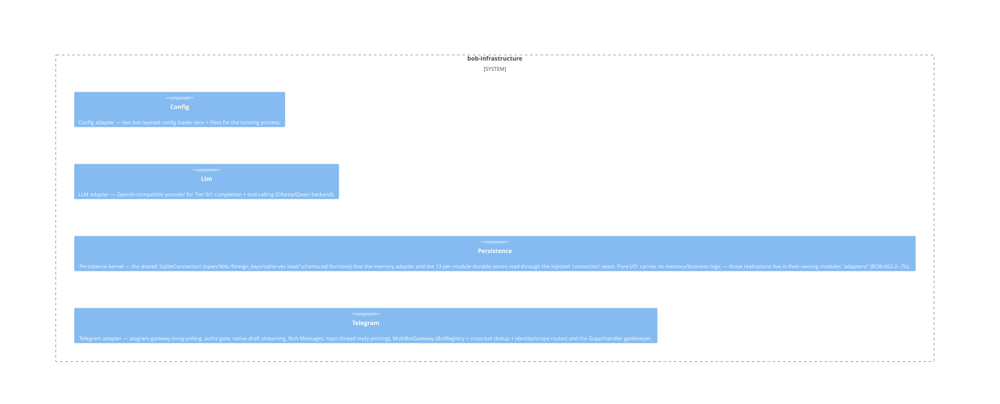

# bob-infrastructure

**Kind:** domain

Port adapters: aiogram Telegram gateway (long-polling + authz gate, native draft streaming, Rich Messages, markdown<->RichMessage, topic-thread reply pinning), MultiBotGateway (BotRegistry + cross-bot dedup + central identity/scope router) and the GuppiHandler gatekeeper (visible reject + owner commands), OpenAI-compatible LLM provider (Tier 0/1 + tool-calling), SQLite+FTS5 persistence, KvAllowlistStore and SoulStore, two-bot layered config loader.

**Source:** `src/bob/infrastructure/`

## Public symbols

- `AuthorizerLike`
- `BobMessageFilter`
- `BotIdentity`
- `BotIdentitySignals`
- `BotLike`
- `BotRegistration`
- `BotRegistry`
- `BotScope`
- `BotUserLike`
- `CodingAssistantLike`
- `ConfigLoader`
- `GoalStoreLike`
- `GuppiHandler`
- `MarkdownSendBot`
- `MarkdownToRichMessage`
- `MessageEntityLike`
- `MessageLike`
- `MessageReactionCountUpdatedLike`
- `MessageReactionUpdatedLike`
- `MultiBotGateway`
- `OpenAICompatProvider`
- `ProactivityStoreLike`
- `PursuitStoreLike`
- `RichMarkdownSender`
- `RichMessageSerializer`
- `RuleStoreLike`
- `SqliteConnection`
- `TelegramGateway`
- `UpdateLike`
- `build_tier_providers`
- `build_web_search_provider`
- `is_reaction_update`

## Relationships

- **part_of**: [bob](../services/bob.md)
- **depends_on**: [bob-application](../domains/bob-application.md), [bob-domain](../domains/bob-domain.md)
- **Used by**: [runtime](../services/runtime.md)
- **Parts**: [config](../other/config.md), [llm](../other/llm.md), [persistence](../other/persistence.md), [telegram](../other/telegram.md)

## Documentation

- [domains/infrastructure/README.md](/docs/domains/infrastructure/README.md)

## Diagram

