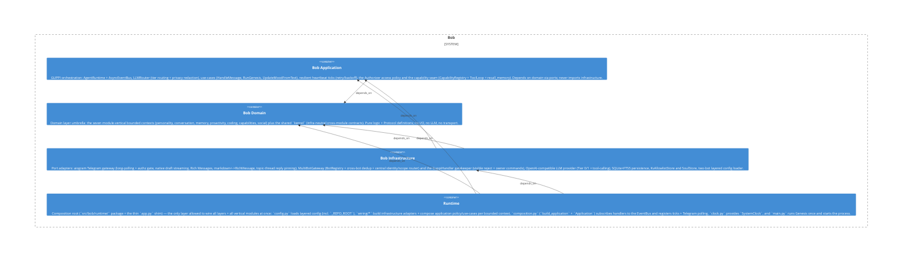

# capabilities

**Kind:** feature

Capabilities module («Bob's tools») — the full vertical GUPPI tool seam in one place: `ports.py` (Capability contract + tool/web/diagram/introspection ports) + pure `diagrams`/`introspection` value objects, `usecases/` (CapabilityRegistry + ToolLoop and the skills: recall/search memory, read code/url, web search, render diagram, inspect architecture, progress announcer), and `adapters/` (aiohttp URL reader behind an SSRF guard, mermaid renderer, beadloom/git introspector, Qwen web-search transport). Domain-first slice BOB-062.4.

**Source:** `src/bob/capabilities/`

## Public symbols

- `Capability`
- `CapabilityNotAllowedError`
- `CapabilityRegistry`
- `CollectingDiagramSink`
- `DeniedPathError`
- `DiagramGateway`
- `DiagramRenderError`
- `DiagramRenderer`
- `DiagramResult`
- `DiagramSender`
- `DiagramSink`
- `DisallowedCommandError`
- `GatewayProgressAnnouncer`
- `HttpUrlReader`
- `InterimLineGenerator`
- `IntrospectionError`
- `PrivacyGuard`
- `ProgressAnnouncer`
- `QwenWebSearchProvider`
- `RepoIntrospector`
- `SafeCapabilityDispatcher`
- `SsrfBlockedError`
- `SubprocessMmdcRenderer`
- `SubprocessRepoIntrospector`
- `ToolCall`
- `ToolCallResult`
- `ToolCallingProvider`
- `ToolLoop`
- `UnknownCapabilityError`
- `UrlReadError`
- `UrlReader`
- `WebPage`
- `WebSearchProvider`
- `WebSearchResult`
- `WebSource`
- `build_url_reader`
- `commits_mentioning`
- `extract_mermaid_blocks`
- `feature_doc_dir`
- `make_code_rationale_capability`
- `make_find_file_capability`
- `make_inspect_architecture_capability`
- `make_list_dir_capability`
- `make_list_work_capability`
- `make_read_code_capability`
- `make_read_url_capability`
- `make_recall_memory_capability`
- `make_render_diagram_capability`
- `make_search_memory_capability`
- `make_web_search_capability`
- `normalize_mermaid`
- `parse_bead_refs`
- `strip_mermaid_blocks`

## Relationships

- **part_of**: [bob-domain](../domains/bob-domain.md)
- **depends_on**: [bob-application](../domains/bob-application.md)
- **Used by**: [llm](../other/llm.md), [runtime](../services/runtime.md), [usecases](../features/usecases.md)

## Documentation

- [domains/capabilities/README.md](/docs/domains/capabilities/README.md)

## Diagram

