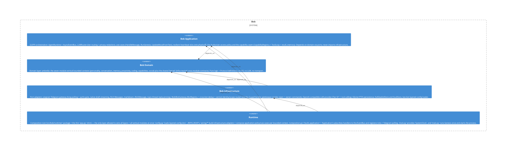

# coding

**Kind:** feature

Coding module («Bob writes code») — the full vertical capability in one place: `ports.py` + pure domain logic, `usecases/` orchestration, and `adapters/` (Claude Code CLI, git worktree, gh PR, session store, indicator). Domain-first slice BOB-062.1.

**Source:** `src/bob/coding/`

## Public symbols

- `ClassifyCodingIntent`
- `ClaudeCodeRunner`
- `ClaudeRunError`
- `CodingAssistant`
- `CodingContext`
- `CodingIntentClassifierLike`
- `CodingIntentRouter`
- `CodingOutcome`
- `CodingSession`
- `CodingSessionState`
- `CodingSessionStore`
- `CommandError`
- `CommandRunner`
- `EditableStatusBot`
- `ExecRunner`
- `GatedCoder`
- `GhPullRequestOpener`
- `GitWorktree`
- `OwnerCheck`
- `OwnerNotifier`
- `PullRequestError`
- `PullRequestOpener`
- `SqliteCodingSessionStore`
- `StatusPanel`
- `StreamLineRunner`
- `SubprocessClaudeRunner`
- `TypingActionBot`
- `TypingKeepalive`
- `Worktree`
- `WorktreeError`
- `accepted`
- `busy`
- `can_approve_plan`
- `can_start`
- `can_stop`
- `can_transition`
- `cannot_approve`
- `failed`
- `is_approval`
- `is_safe_branch`
- `is_stop`
- `is_terminal`
- `make_coding_context`
- `narrate`
- `no_changes`
- `no_session`
- `panel_executing`
- `panel_failed`
- `panel_plan_ready`
- `panel_planning`
- `panel_pr`
- `panel_stopped`
- `plan`
- `pr`
- `status_idle`
- `status_line`
- `stopped`
- `worktree_branch`

## Relationships

- **part_of**: [bob-domain](../domains/bob-domain.md)
- **depends_on**: [router](../features/router.md), [telegram](../other/telegram.md)
- **Used by**: [bob](../services/bob.md), [runtime](../services/runtime.md)

## Documentation

- [domains/coding/README.md](/docs/domains/coding/README.md)

## Diagram

