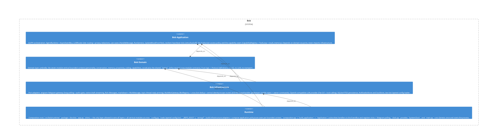

# conversation

**Kind:** feature

Conversation module («how a turn is conducted») — the full turn-conduct vertical in one place: `ports.py` (conversation-floor store, closer log, ZoneClassifier) + pure domain (addressivity, conversation + floor continuity, brevity, engagement, zone classifier, interim line, response choice, response/volatility judgments), `usecases/` (decide_response), and `adapters/` (Tier-0 response/volatility/interim judges + SQLite conversation-floor & closer-log stores). Depends on personality one-directionally. Domain-first slice BOB-062.6a.

**Source:** `src/bob/conversation/`

## Public symbols

- `Addressivity`
- `AddressivityPerceiver`
- `AddressivityThresholds`
- `AnswerDemand`
- `AntiRepeatGuard`
- `BatchAmbientMessage`
- `BatchRoomReader`
- `BatchRoomReading`
- `BatchRoomReadingContext`
- `BrevityThresholds`
- `CloserLog`
- `ConversationFloor`
- `ConversationFloorStore`
- `ConversationalFatigue`
- `DecideResponse`
- `EngagementModel`
- `EngagementThresholds`
- `FatigueRates`
- `FloorConfig`
- `FloorHolder`
- `FloorManager`
- `FloorResolution`
- `LlmBatchRoomReader`
- `LlmInterimLineGenerator`
- `LlmResponseJudge`
- `LlmRoomReader`
- `LlmVolatilityJudge`
- `OutgoingTarget`
- `ReadTheRoom`
- `RecallAssembler`
- `ReflectiveIntent`
- `ReflectiveVerdict`
- `RepeatThresholds`
- `ResponseChoice`
- `ResponseContext`
- `ResponseIntent`
- `ResponseJudge`
- `ResponseJudgeParseError`
- `ResponseOutcome`
- `RoomMood`
- `RoomReader`
- `RoomReading`
- `RoomReadingContext`
- `RoomReadingParseError`
- `SqliteCloserLog`
- `SqliteConversationFloorStore`
- `TasteZoneClassifier`
- `TurnGate`
- `VerdictKind`
- `VerifyInterimAnnouncer`
- `VerifyStep`
- `VolatilityContext`
- `VolatilityJudge`
- `VolatilityJudgeParseError`
- `VolatilityVerdict`
- `ZoneClassifier`
- `advance_floor`
- `appetite_of`
- `build_batch_room_prompt`
- `build_interim_line_user_prompt`
- `build_judgment_user_prompt`
- `build_room_prompt`
- `build_volatility_user_prompt`
- `clamp_reply`
- `classify_addressivity`
- `classify_answer_demand`
- `clean_interim_line`
- `closer_text`
- `decide_batch`
- `decide_engagement`
- `decide_from_reading`
- `decide_response`
- `decide_verbosity`
- `engagement_mood_lift`
- `idle_floor`
- `is_bob_repeat`
- `is_floor_participant`
- `is_phrase_tic`
- `is_recurring_closer_tic`
- `is_same_closer_motif`
- `is_user_repeat`
- `others_present`
- `parse_batch_reading`
- `parse_response_choice`
- `parse_room_reading`
- `parse_volatility_verdict`
- `recalled_bob_replies`
- `recalled_bob_reply`
- `recalled_excluding_reflections`
- `recalled_without_copied_exemplars`
- `recurring_closer`
- `resolve_addressivity`
- `resolve_outgoing_target`
- `strip_recurring_closer`
- `topic_interest`
- `validate_reaction_emoji`

## Relationships

- **part_of**: [bob-domain](../domains/bob-domain.md)
- **depends_on**: [personality](../features/personality.md), [router](../features/router.md)
- **Used by**: [proactivity](../features/proactivity.md), [runtime](../services/runtime.md), [runtime-app](../features/runtime-app.md), [usecases](../features/usecases.md)

## Documentation

- [domains/conversation/README.md](/docs/domains/conversation/README.md)

## Diagram

