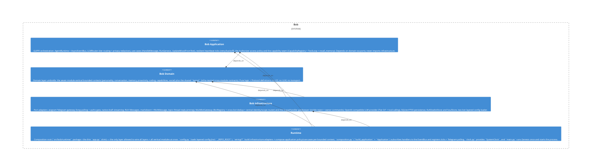

# memory

**Kind:** feature

Memory module («Bob remembers») — the full vertical capability in one place: `ports.py` + pure `entities`, `usecases/` (extract facts, consolidate, dedup), and `adapters/` (FTS5/hybrid recall + local Ollama embedder/reranker). Domain-first slice BOB-062.2.

**Source:** `src/bob/memory/`

## Public symbols

- `ConsolidateMemory`
- `ConsolidationStore`
- `DedupFacts`
- `DedupStore`
- `Embedder`
- `EpisodicEvent`
- `ExtractFacts`
- `FactWriter`
- `Fts5MemoryRecall`
- `HybridMemoryRecall`
- `MemoryRecall`
- `MemoryRepo`
- `MemoryVectorStore`
- `OllamaEmbedder`
- `OllamaReranker`
- `Reranker`
- `SemanticFact`
- `SqliteMemoryRepo`
- `build_embedder`
- `build_reranker`

## Relationships

- **part_of**: [bob-domain](../domains/bob-domain.md)
- **depends_on**: [persistence](../other/persistence.md), [personality](../features/personality.md), [router](../features/router.md), [runtime-app](../features/runtime-app.md)
- **Used by**: [proactivity](../features/proactivity.md), [runtime](../services/runtime.md), [usecases](../features/usecases.md)

## Documentation

- [domains/memory/README.md](/docs/domains/memory/README.md)

## Diagram

