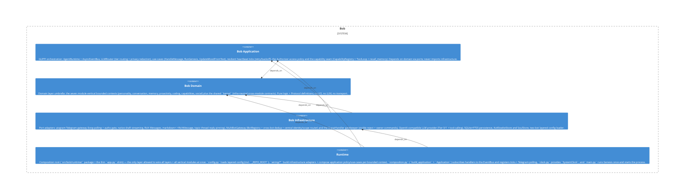

# personality

**Kind:** feature

Personality module («who Bob is») — the full character vertical in one place: `ports.py` + pure domain (Mood five-axis affect, TasteEngine + evolution, disposition, fascination + phantoms, language/profanity, expression incl. verbosity/engagement vocabulary, voice, the reaction family, negotiation stance, reflection, absence), `usecases/` (update mood from text, apply/reappraise/parse reflection, evolve fascination/phantoms), and `adapters/` (Tier-0 reaction judge + SQLite/kv fascination & notable-reaction stores). Domain-first slice BOB-062.6a. (Being-received reaction perception is a cross-domain use-case over mood + relationship, so it lives in `application/usecases/perceive_reaction`, not here.)

**Source:** `src/bob/personality/`

## Public symbols

- `ApplyReflection`
- `Disposition`
- `EngagementLevel`
- `EvolveFascination`
- `EvolvePhantoms`
- `ExpressionFreqs`
- `ExpressionMode`
- `ExpressionPlan`
- `ExpressionSignals`
- `Fascination`
- `FascinationGrounding`
- `FascinationStore`
- `FormHint`
- `GroundedAddons`
- `HeuristicReflectionParser`
- `KvNotableReactionStore`
- `LlmReactionJudge`
- `MessageReactor`
- `Mood`
- `MoodDelta`
- `MoodPerceiver`
- `Negotiation`
- `NegotiationZone`
- `NotableReaction`
- `NotableReactionStore`
- `OffDayThresholds`
- `PhantomProfileWriter`
- `PhantomSignals`
- `ReactionContext`
- `ReactionJudge`
- `ReactionJudgeParseError`
- `ReactionMeaning`
- `ReappraisalOutcome`
- `ReappraiseReflection`
- `ReflectionOutcome`
- `ReflectionParser`
- `ReflectionReader`
- `ReflectionSignal`
- `RelationshipToneThresholds`
- `RepoFascinationGrounding`
- `RoomToneThresholds`
- `SOUL`
- `SqliteFascinationStore`
- `Stance`
- `StoreFascinationReader`
- `TasteAxis`
- `TasteEngine`
- `TextSignals`
- `UpdateMoodFromText`
- `Verbosity`
- `Verdict`
- `VoiceComposer`
- `absence_hint`
- `acknowledgment_hint`
- `anti_bait_directive`
- `apply_reaction_to_mood`
- `brevity_directive`
- `brevity_few_shot`
- `build_monologue_prompt`
- `build_reaction_user_prompt`
- `build_reflection_prompt`
- `decide_expression`
- `disclosure_refusal_directive`
- `engagement_directive`
- `evolve_phantoms`
- `experiment_bias`
- `guppi_canon`
- `improvement_directive`
- `is_directed_hostility`
- `language_directive`
- `modulate`
- `nudge_relationship_warmth`
- `parse_reaction_meaning`
- `profanity_stance`
- `reaction_emoji_for`
- `recalled_impression_directive`
- `reinforce`
- `relationship_tone_directive`
- `room_engagement_bias`
- `room_tone_directive`
- `select_reflection_angle`
- `stranger_directive`
- `sulk_directive`
- `tactful_withhold_directive`
- `tone_directive`
- `user_repeat_directive`
- `variable_form_directive`
- `who_is_writing_directive`

## Relationships

- **part_of**: [bob-domain](../domains/bob-domain.md)
- **depends_on**: [router](../features/router.md)
- **Used by**: [conversation](../features/conversation.md), [memory](../features/memory.md), [proactivity](../features/proactivity.md), [runtime](../services/runtime.md), [social](../features/social.md), [usecases](../features/usecases.md)

## Documentation

- [domains/personality/README.md](/docs/domains/personality/README.md)

## Diagram

