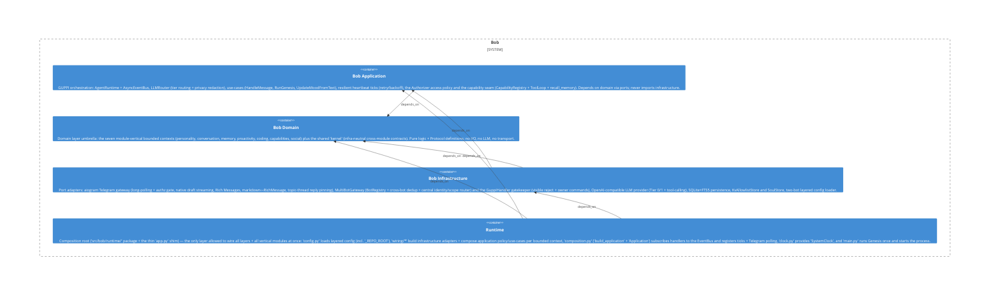

# proactivity

**Kind:** feature

Proactivity module («Bob's background life») — the full vertical capability in one place: `ports.py` + pure domain (drive-model urge/governance/social-energy, goals graph, self-improvement rules), `usecases/` (engine/tick, plan/pursue goals, detect-patterns/announce-rules), and `adapters/` (proactivity/goal/self-improvement stores + live read-seams). Domain-first slice BOB-062.3.

**Source:** `src/bob/proactivity/`

## Public symbols

- `ActiveRulesReader`
- `AnnounceProposedRules`
- `DetectPatterns`
- `EpisodeWriter`
- `Goal`
- `GoalGraph`
- `GoalOrigin`
- `GoalState`
- `GoalStore`
- `GoalStoreLike`
- `Governance`
- `GovernanceConfig`
- `HistorySource`
- `ImprovementRule`
- `ImprovementSignals`
- `Lever`
- `LlmPatternDetector`
- `LlmPlanner`
- `PatternDetector`
- `PlanGoal`
- `PlanResult`
- `Planner`
- `ProactiveDecider`
- `ProactiveHistory`
- `ProactiveRunner`
- `ProactiveTick`
- `ProactiveWindowCounter`
- `ProactivityEngine`
- `ProactivityState`
- `ProactivityStore`
- `ProactivityStoreLike`
- `ProgressWindowCounter`
- `PursueGoalsTick`
- `PursuitStore`
- `RecordOwnerActivity`
- `ReflectionSalienceSource`
- `RepoProactivitySources`
- `RuleAnnounceGateway`
- `RuleLoader`
- `RuleModulators`
- `RuleOrigin`
- `RuleReader`
- `RuleState`
- `SafeDispatcher`
- `SelfImprovementStore`
- `ShareCeiling`
- `SignalSource`
- `SocialEnergy`
- `SqliteGoalStore`
- `SqliteProactivityStore`
- `SqliteSelfImprovementStore`
- `SulkSource`
- `Task`
- `TaskState`
- `UrgeModel`
- `active_rules`
- `blocked_reason`
- `build_modulators`
- `can_transition`
- `can_transition_task`
- `clamp_magnitude`
- `external_agency_tasks`
- `is_duplicate_rule`
- `is_goal_complete`
- `next_safe_task`
- `ready_tasks`
- `rules_for_lever`
- `urge_to_probability`

## Relationships

- **part_of**: [bob-domain](../domains/bob-domain.md)
- **depends_on**: [conversation](../features/conversation.md), [memory](../features/memory.md), [personality](../features/personality.md), [router](../features/router.md)
- **Used by**: [runtime](../services/runtime.md), [telegram](../other/telegram.md), [usecases](../features/usecases.md)

## Documentation

- [domains/proactivity/README.md](/docs/domains/proactivity/README.md)

## Diagram

