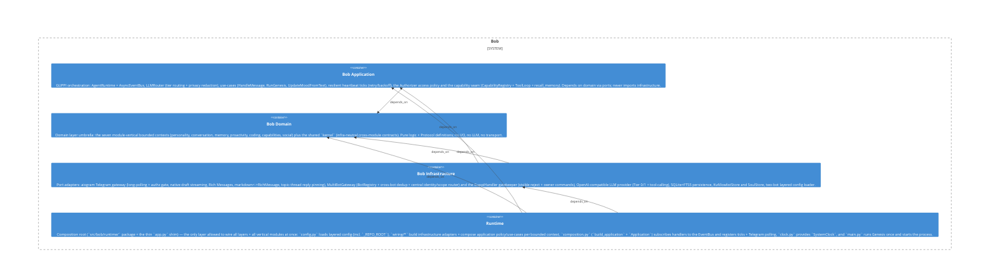

# social

**Kind:** feature

Social module («Bob distinguishes people») — the full vertical capability in one place: `ports.py` + pure domain (interlocutor identity, first-impression, relationship, sulk) + `permission/` value objects, `usecases/` (authorizer/sender+reactor perception, permission flow/execution, first-impression/relationship/sulk sources, run-genesis), and `adapters/` (first-impression/relationship/sulk/allowlist/permission-request/soul stores + privilege-judge). Domain-first slice BOB-062.5.

**Source:** `src/bob/social/`

## Public symbols

- `AllowlistStore`
- `Authorizer`
- `DurableAuthorizer`
- `FirstImpression`
- `FirstImpressionStore`
- `FirstImpressionTracker`
- `GenesisError`
- `GenesisResult`
- `GroupSilentAnnouncer`
- `Interlocutor`
- `InterlocutorKind`
- `KvAllowlistStore`
- `LlmPrivilegeJudge`
- `PermissionDecision`
- `PermissionExecutor`
- `PermissionExecutorLike`
- `PermissionFlow`
- `PermissionNotifier`
- `PermissionRequest`
- `PermissionRequestStoreLike`
- `PermissionState`
- `PersonSulkStore`
- `PrivilegeContext`
- `PrivilegeJudge`
- `PrivilegeJudgeParseError`
- `PrivilegeNeed`
- `PrivilegedFulfiller`
- `ReactorPerception`
- `Relationship`
- `RelationshipDeltas`
- `RelationshipStore`
- `RelationshipTracker`
- `RequesterChannel`
- `RunGenesis`
- `SenderPerception`
- `SocialContext`
- `SoulStore`
- `SqliteFirstImpressionStore`
- `SqlitePermissionRequestStore`
- `SqlitePersonSulkStore`
- `SqliteRelationshipStore`
- `SqliteSulkStore`
- `SulkAnnouncer`
- `SulkConfig`
- `SulkRecoveryStep`
- `SulkState`
- `SulkStore`
- `SulkTracker`
- `Trust`
- `apply_interaction`
- `build_privilege_user_prompt`
- `classify`
- `compromise_bias`
- `detected_endorsement`
- `endorsed_seed`
- `endorsement_seed`
- `filter_surfaceable`
- `impression_note_for`
- `is_authorize`
- `is_deny`
- `is_grant`
- `may_surface`
- `observe_relationship`
- `owner_endorsed_sender`
- `parse_privilege_need`
- `recover`
- `visibility_for_scope`

## Relationships

- **part_of**: [bob-domain](../domains/bob-domain.md)
- **depends_on**: [personality](../features/personality.md), [router](../features/router.md), [telegram](../other/telegram.md)
- **Used by**: [bob](../services/bob.md), [runtime](../services/runtime.md), [usecases](../features/usecases.md)

## Documentation

- [domains/social/README.md](/docs/domains/social/README.md)

## Diagram

