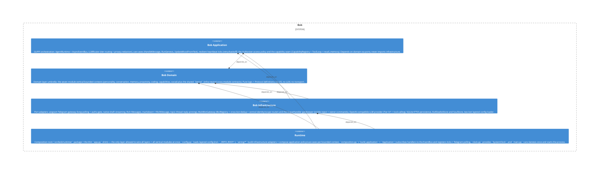

# usecases

**Kind:** feature

Use-cases — HandleMessage, RunGenesis, UpdateMoodFromText, goal/memory/reflection flows orchestrating domain + ports.

**Source:** `src/bob/application/usecases/`

## Public symbols

- `BargeCeiling`
- `BobMessageLookup`
- `BobUserIdSource`
- `CatchUp`
- `CatchUpOutcome`
- `CurrentFascinationReader`
- `DisclosureGuard`
- `EndorsementSeeder`
- `EngagementState`
- `EpisodeReader`
- `EpisodeWriter`
- `EssentialRunner`
- `FactDeduper`
- `FascinationEvolver`
- `FirstImpressionReader`
- `HandleMessage`
- `InnerMonologueTick`
- `InterlocutorResolver`
- `MemoryConsolidator`
- `MoodDriftTick`
- `NaturalCodingRouter`
- `OutageNotifier`
- `OwnerActivityRecorder`
- `PatternDetectorStep`
- `PerceiveReaction`
- `PermissionFlowLike`
- `PersonalityState`
- `PhantomEvolver`
- `PreComposeGate`
- `PrivilegedRequestFulfiller`
- `ReactionMemoryWriter`
- `ReactorResolver`
- `Reappraiser`
- `ReflectTick`
- `ReflectionContext`
- `RelationshipReader`
- `ReplyDelay`
- `ReplyGateway`
- `RoomMoodModulator`
- `RuleAnnouncerStep`
- `SelfImprovementReader`
- `SulkReader`
- `SulkRecoverer`
- `TasteProfileWriter`
- `reply_delay_inputs`
- `to_backlog_message`

## Relationships

- **part_of**: [bob-application](../domains/bob-application.md)
- **depends_on**: [bob-application](../domains/bob-application.md), [capabilities](../features/capabilities.md), [conversation](../features/conversation.md), [memory](../features/memory.md), [personality](../features/personality.md), [presence](../features/presence.md), [proactivity](../features/proactivity.md), [router](../features/router.md), [social](../features/social.md)
- **Used by**: [runtime](../services/runtime.md)

## Documentation

- [domains/application/features/usecases/SPEC.md](/docs/domains/application/features/usecases/SPEC.md)

## Diagram

