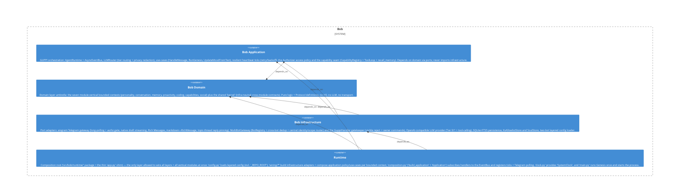

# telegram

**Kind:** component

Telegram adapter — aiogram gateway (long-polling, authz gate, native draft streaming, Rich Messages, topic-thread reply pinning), MultiBotGateway (BotRegistry + cross-bot dedup + identity/scope router) and the GuppiHandler gatekeeper.

**Source:** `src/bob/infrastructure/telegram/`

## Public symbols

- `AuthorizerLike`
- `BobMessageFilter`
- `BotIdentity`
- `BotIdentitySignals`
- `BotLike`
- `BotRegistration`
- `BotRegistry`
- `BotScope`
- `BotUserLike`
- `CodingAssistantLike`
- `GoalStoreLike`
- `GuppiHandler`
- `MarkdownSendBot`
- `MarkdownToRichMessage`
- `MessageEntityLike`
- `MessageLike`
- `MessageReactionCountUpdatedLike`
- `MessageReactionUpdatedLike`
- `MultiBotGateway`
- `ProactivityStoreLike`
- `PursuitStoreLike`
- `RichMarkdownSender`
- `RichMessageSerializer`
- `RuleStoreLike`
- `TelegramGateway`
- `UpdateLike`
- `is_reaction_update`

## Relationships

- **part_of**: [bob-infrastructure](../domains/bob-infrastructure.md)
- **depends_on**: [bob-application](../domains/bob-application.md), [proactivity](../features/proactivity.md), [runtime-app](../features/runtime-app.md)
- **Used by**: [bob](../services/bob.md), [coding](../features/coding.md), [runtime](../services/runtime.md), [social](../features/social.md)

## Documentation

- [domains/infrastructure/features/telegram/SPEC.md](/docs/domains/infrastructure/features/telegram/SPEC.md)

## Diagram

