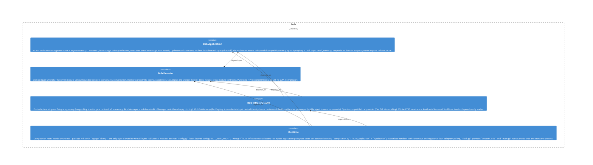

# bob

**Kind:** service

Bob — Telegram-native companion agent: GUPPI process, LLM Tier 0/1 router with privacy redaction, SQLite+FTS5 memory, Higher Mind, Genesis, heartbeat. Two admin bots in one process (BOB-003): a MultiBotGateway (BotRegistry) polls both Bob and GUPPI, dedups cross-bot by (chat_id, message_id), and a central router dispatches by identity+scope — Bob lives in his forum topic, GUPPI is the gatekeeper in General with a visible unauthorized reject + owner commands. aiogram transport (native draft streaming + Rich Messages), owner/allowlist/chat-scope authz, resilient ticks, and a capability seam (registry + tool-loop) executed by GUPPI.

**Source:** `src/bob/`

## Public symbols

- `ActiveRulesReader`
- `Addressivity`
- `AddressivityPerceiver`
- `AddressivityThresholds`
- `AgentRuntime`
- `AllowlistStore`
- `AmbientBatchReader`
- `AnnounceProposedRules`
- `AnswerDemand`
- `AntiRepeatGuard`
- `Application`
- `ApplyReflection`
- `ArrivedMessage`
- `AsyncEventBus`
- `Authorizer`
- `AuthorizerLike`
- `BacklogMessage`
- `BacklogScorer`
- `BargeCeiling`
- `BatchAmbientMessage`
- `BatchRoomReader`
- `BatchRoomReading`
- `BatchRoomReadingContext`
- `BobMessageFilter`
- `BobMessageLookup`
- `BobMessageReaction`
- `BobUserIdSource`
- `BotIdentity`
- `BotIdentitySignals`
- `BotLike`
- `BotRegistration`
- `BotRegistry`
- `BotScope`
- `BotUserLike`
- `BrevityThresholds`
- `Capability`
- `CapabilityNotAllowedError`
- `CapabilityRegistry`
- `CatchUp`
- `CatchUpOutcome`
- `CatchUpPlan`
- `CatchUpReentry`
- `CatchUpSelection`
- `ChatDispatcher`
- `ChatInbox`
- `ClassifyCodingIntent`
- `ClaudeCodeRunner`
- `ClaudeRunError`
- `Clock`
- `CloserLog`
- `CodingAssistant`
- `CodingAssistantLike`
- `CodingContext`
- `CodingIntentClassifierLike`
- `CodingIntentRouter`
- `CodingOutcome`
- `CodingSession`
- `CodingSessionState`
- `CodingSessionStore`
- `CollectingDiagramSink`
- `CommandError`
- `CommandRunner`
- `ConfigLoader`
- `ConsolidateMemory`
- `ConsolidationStore`
- `ConversationFloor`
- `ConversationFloorStore`
- `ConversationalFatigue`
- `CurrentFascinationReader`
- `DecideResponse`
- `DedupFacts`
- `DedupStore`
- `DelayedTurn`
- `DeniedPathError`
- `DetectPatterns`
- `DiagramGateway`
- `DiagramRenderError`
- `DiagramRenderer`
- `DiagramResult`
- `DiagramSender`
- `DiagramSink`
- `DisallowedCommandError`
- `DisclosureGuard`
- `Disposition`
- `DomainEvent`
- `DurableAuthorizer`
- `EditableStatusBot`
- `Embedder`
- `EndorsementSeeder`
- `EngagementLevel`
- `EngagementModel`
- `EngagementState`
- `EngagementThresholds`
- `EpisodeReader`
- `EpisodeWriter`
- `EpisodicEvent`
- `EpisodicOutgoingActivityStore`
- `EssentialRunner`
- `EventBus`
- `EvolveFascination`
- `EvolvePhantoms`
- `ExecRunner`
- `ExpressionFreqs`
- `ExpressionMode`
- `ExpressionPlan`
- `ExpressionSignals`
- `ExtractFacts`
- `FactDeduper`
- `FactWriter`
- `Fascination`
- `FascinationEvolver`
- `FascinationGrounding`
- `FascinationStore`
- `FatigueRates`
- `FirstImpression`
- `FirstImpressionReader`
- `FirstImpressionStore`
- `FirstImpressionTracker`
- `FloorConfig`
- `FloorHolder`
- `FloorManager`
- `FloorResolution`
- `FormHint`
- `Fts5MemoryRecall`
- `GatedCoder`
- `GatewayProgressAnnouncer`
- `GenesisError`
- `GenesisResult`
- `GhPullRequestOpener`
- `GitWorktree`
- `Goal`
- `GoalGraph`
- `GoalOrigin`
- `GoalState`
- `GoalStore`
- `GoalStoreLike`
- `Governance`
- `GovernanceConfig`
- `GroundedAddons`
- `GroupSilentAnnouncer`
- `GuppiHandler`
- `HandleMessage`
- `HeuristicReflectionParser`
- `HistorySource`
- `HttpUrlReader`
- `HybridMemoryRecall`
- `ImprovementRule`
- `ImprovementSignals`
- `InnerMonologueTick`
- `InterimLineGenerator`
- `Interlocutor`
- `InterlocutorKind`
- `InterlocutorResolver`
- `IntrospectionError`
- `KvAllowlistStore`
- `KvNotableReactionStore`
- `LLMProvider`
- `LLMRequest`
- `LLMRouter`
- `Lever`
- `LlmBatchRoomReader`
- `LlmInterimLineGenerator`
- `LlmPatternDetector`
- `LlmPlanner`
- `LlmPrivilegeJudge`
- `LlmReactionJudge`
- `LlmResponseJudge`
- `LlmRoomReader`
- `LlmStalenessJudge`
- `LlmVolatilityJudge`
- `MarkdownSendBot`
- `MarkdownToRichMessage`
- `MemoryConsolidator`
- `MemoryRecall`
- `MemoryRepo`
- `MemoryVectorStore`
- `MessageEntityLike`
- `MessageLike`
- `MessageReactionCountUpdatedLike`
- `MessageReactionUpdatedLike`
- `MessageReactor`
- `MessageReceived`
- `Mood`
- `MoodDelta`
- `MoodDriftTick`
- `MoodPerceiver`
- `MultiBotGateway`
- `NaturalCodingRouter`
- `NaturalDelayPolicy`
- `Negotiation`
- `NegotiationZone`
- `NotableReaction`
- `NotableReactionStore`
- `OffDayThresholds`
- `OllamaEmbedder`
- `OllamaReranker`
- `OpenAICompatProvider`
- `OutageNotifier`
- `OutgoingActivity`
- `OutgoingActivityStore`
- `OutgoingTarget`
- `OwnerActivityRecorder`
- `OwnerCheck`
- `OwnerNotifier`
- `PatternDetector`
- `PatternDetectorStep`
- `PerceiveReaction`
- `PermissionDecision`
- `PermissionExecutor`
- `PermissionExecutorLike`
- `PermissionFlow`
- `PermissionFlowLike`
- `PermissionNotifier`
- `PermissionRequest`
- `PermissionRequestStoreLike`
- `PermissionState`
- `PersonSulkStore`
- `PersonalityState`
- `PhantomEvolver`
- `PhantomProfileWriter`
- `PhantomSignals`
- `PlanGoal`
- `PlanResult`
- `Planner`
- `PreComposeGate`
- `PrivacyGuard`
- `PrivilegeContext`
- `PrivilegeJudge`
- `PrivilegeJudgeParseError`
- `PrivilegeNeed`
- `PrivilegedFulfiller`
- `PrivilegedRequestFulfiller`
- `ProactiveDecider`
- `ProactiveHistory`
- `ProactiveRunner`
- `ProactiveTick`
- `ProactiveWindowCounter`
- `ProactivityEngine`
- `ProactivityState`
- `ProactivityStore`
- `ProactivityStoreLike`
- `ProgressAnnouncer`
- `ProgressWindowCounter`
- `PullRequestError`
- `PullRequestOpener`
- `PursueGoalsTick`
- `PursuitStore`
- `PursuitStoreLike`
- `QueuedAmbient`
- `QwenWebSearchProvider`
- `ReactionBudget`
- `ReactionContext`
- `ReactionJudge`
- `ReactionJudgeParseError`
- `ReactionMeaning`
- `ReactionMemoryWriter`
- `ReactorPerception`
- `ReactorResolver`
- `ReadTheRoom`
- `ReappraisalOutcome`
- `ReappraiseReflection`
- `Reappraiser`
- `RecallAssembler`
- `RecordOwnerActivity`
- `ReflectTick`
- `ReflectionContext`
- `ReflectionOutcome`
- `ReflectionParser`
- `ReflectionReader`
- `ReflectionSalienceSource`
- `ReflectionSignal`
- `ReflectiveIntent`
- `ReflectiveVerdict`
- `Relationship`
- `RelationshipDeltas`
- `RelationshipReader`
- `RelationshipStore`
- `RelationshipToneThresholds`
- `RelationshipTracker`
- `RepeatThresholds`
- `ReplyDelay`
- `ReplyGateway`
- `RepoFascinationGrounding`
- `RepoIntrospector`
- `RepoProactivitySources`
- `RequesterChannel`
- `Reranker`
- `ResponseChoice`
- `ResponseContext`
- `ResponseIntent`
- `ResponseJudge`
- `ResponseJudgeParseError`
- `ResponseOutcome`
- `RetryPolicy`
- `RhythmConfig`
- `RhythmWiring`
- `RichMarkdownSender`
- `RichMessageSerializer`
- `RoomMood`
- `RoomMoodModulator`
- `RoomReader`
- `RoomReading`
- `RoomReadingContext`
- `RoomReadingParseError`
- `RoomStreamReader`
- `RoomToneThresholds`
- `RuleAnnounceGateway`
- `RuleAnnouncerStep`
- `RuleLoader`
- `RuleModulators`
- `RuleOrigin`
- `RuleReader`
- `RuleState`
- `RuleStoreLike`
- `RunGenesis`
- `RuntimeState`
- `SOUL`
- `SafeCapabilityDispatcher`
- `SafeDispatcher`
- `SelfImprovementReader`
- `SelfImprovementStore`
- `SemanticFact`
- `SenderPerception`
- `SeriesAction`
- `ShareCeiling`
- `ShareOfVoiceGate`
- `ShareOfVoicePolicy`
- `SignalSource`
- `SocialContext`
- `SocialEnergy`
- `SoulStore`
- `SqliteCloserLog`
- `SqliteCodingSessionStore`
- `SqliteConnection`
- `SqliteConversationFloorStore`
- `SqliteFascinationStore`
- `SqliteFirstImpressionStore`
- `SqliteGoalStore`
- `SqliteMemoryRepo`
- `SqlitePermissionRequestStore`
- `SqlitePersonSulkStore`
- `SqliteProactivityStore`
- `SqliteRelationshipStore`
- `SqliteSelfImprovementStore`
- `SqliteSulkStore`
- `SsrfBlockedError`
- `StalenessContext`
- `StalenessGate`
- `StalenessJudge`
- `StalenessOutcome`
- `StalenessReading`
- `StalenessReassessor`
- `Stance`
- `StatusPanel`
- `StoreFascinationReader`
- `StreamLineRunner`
- `SubprocessClaudeRunner`
- `SubprocessMmdcRenderer`
- `SubprocessRepoIntrospector`
- `SulkAnnouncer`
- `SulkConfig`
- `SulkReader`
- `SulkRecoverer`
- `SulkRecoveryStep`
- `SulkSource`
- `SulkState`
- `SulkStore`
- `SulkTracker`
- `SystemClock`
- `Task`
- `TaskState`
- `TaskType`
- `TasteAxis`
- `TasteEngine`
- `TasteProfileWriter`
- `TasteZoneClassifier`
- `TelegramGateway`
- `TextSignals`
- `ToolCall`
- `ToolCallResult`
- `ToolCallingProvider`
- `ToolLoop`
- `Trust`
- `TurnGate`
- `TurnScope`
- `TypingActionBot`
- `TypingKeepalive`
- `UnknownCapabilityError`
- `UpdateLike`
- `UpdateMoodFromText`
- `UrgeModel`
- `UrlReadError`
- `UrlReader`
- `Verbosity`
- `Verdict`
- `VerdictKind`
- `VerifyInterimAnnouncer`
- `VerifyStep`
- `VoiceComposer`
- `VolatilityContext`
- `VolatilityJudge`
- `VolatilityJudgeParseError`
- `VolatilityVerdict`
- `WebPage`
- `WebSearchProvider`
- `WebSearchResult`
- `WebSource`
- `Worktree`
- `WorktreeError`
- `ZoneClassifier`
- `absence_hint`
- `accepted`
- `acknowledgment_hint`
- `active_rules`
- `advance_floor`
- `anti_bait_directive`
- `appetite_of`
- `apply_interaction`
- `apply_reaction_to_mood`
- `batch_grew`
- `blocked_reason`
- `brevity_directive`
- `brevity_few_shot`
- `build_application`
- `build_batch_room_prompt`
- `build_batch_room_reader`
- `build_catch_up_reentry`
- `build_disclosure_guard`
- `build_embedder`
- `build_endorsement_seeder`
- `build_interim_line_user_prompt`
- `build_judgment_user_prompt`
- `build_modulators`
- `build_monologue_prompt`
- `build_privilege_user_prompt`
- `build_reaction_user_prompt`
- `build_reflection_prompt`
- `build_reranker`
- `build_rhythm_wiring`
- `build_room_mood_modulator`
- `build_room_prompt`
- `build_staleness_reassessor`
- `build_staleness_user_prompt`
- `build_tier_providers`
- `build_url_reader`
- `build_volatility_user_prompt`
- `build_web_search_provider`
- `busy`
- `call_with_retry`
- `can_approve_plan`
- `can_start`
- `can_stop`
- `can_transition`
- `can_transition_task`
- `cannot_approve`
- `clamp_magnitude`
- `clamp_reply`
- `clamp_unit`
- `classify`
- `classify_addressivity`
- `classify_answer_demand`
- `clean_interim_line`
- `closer_text`
- `coalesce_stale`
- `commits_mentioning`
- `compromise_bias`
- `decide_batch`
- `decide_engagement`
- `decide_expression`
- `decide_from_reading`
- `decide_response`
- `decide_staleness`
- `decide_verbosity`
- `delay_floor_seconds`
- `derive_turn_seed`
- `detected_endorsement`
- `disclosure_refusal_directive`
- `endorsed_seed`
- `endorsement_seed`
- `engagement_directive`
- `engagement_mood_lift`
- `evolve_phantoms`
- `experiment_bias`
- `external_agency_tasks`
- `extract_mermaid_blocks`
- `failed`
- `fair_target_share`
- `feature_doc_dir`
- `filter_surfaceable`
- `guppi_canon`
- `idle_floor`
- `impression_note_for`
- `improvement_directive`
- `is_approval`
- `is_authorize`
- `is_bob_repeat`
- `is_deny`
- `is_directed_hostility`
- `is_duplicate_rule`
- `is_floor_participant`
- `is_goal_complete`
- `is_grant`
- `is_phrase_tic`
- `is_reaction_update`
- `is_recurring_closer_tic`
- `is_reentry`
- `is_safe_branch`
- `is_same_closer_motif`
- `is_stop`
- `is_terminal`
- `is_transient`
- `is_user_repeat`
- `language_directive`
- `main`
- `make_code_rationale_capability`
- `make_coding_context`
- `make_find_file_capability`
- `make_focus_predicate`
- `make_inspect_architecture_capability`
- `make_list_dir_capability`
- `make_list_work_capability`
- `make_read_code_capability`
- `make_read_url_capability`
- `make_recall_memory_capability`
- `make_render_diagram_capability`
- `make_search_memory_capability`
- `make_web_search_capability`
- `may_surface`
- `message_is_focused`
- `modulate`
- `narrate`
- `new_turn_scope`
- `next_safe_task`
- `no_changes`
- `no_session`
- `normalize_mermaid`
- `nothing_arrived`
- `nudge_relationship_warmth`
- `observe_relationship`
- `others_present`
- `owner_endorsed_sender`
- `panel_executing`
- `panel_failed`
- `panel_plan_ready`
- `panel_planning`
- `panel_pr`
- `panel_stopped`
- `parse_batch_reading`
- `parse_bead_refs`
- `parse_privilege_need`
- `parse_reaction_meaning`
- `parse_response_choice`
- `parse_room_reading`
- `parse_staleness_reading`
- `parse_volatility_verdict`
- `periodic`
- `plan`
- `plan_series_actions`
- `pr`
- `profanity_stance`
- `rank`
- `reaction_allowed`
- `reaction_emoji_for`
- `ready_tasks`
- `recalled_bob_replies`
- `recalled_bob_reply`
- `recalled_excluding_reflections`
- `recalled_impression_directive`
- `recalled_without_copied_exemplars`
- `recover`
- `recurring_closer`
- `reinforce`
- `relationship_tone_directive`
- `reply_delay_inputs`
- `resolve_addressivity`
- `resolve_outgoing_target`
- `retry_with_backoff`
- `room_engagement_bias`
- `room_tone_directive`
- `rules_for_lever`
- `score`
- `select_catchup`
- `select_reflection_angle`
- `select_reply_tier`
- `share_damping`
- `should_debounce`
- `staleness_enabled`
- `status_idle`
- `status_line`
- `stopped`
- `stranger_directive`
- `strip_mermaid_blocks`
- `strip_recurring_closer`
- `sulk_directive`
- `tactful_withhold_directive`
- `to_backlog_message`
- `tone_directive`
- `topic_interest`
- `urge_to_probability`
- `user_repeat_directive`
- `validate_reaction_emoji`
- `variable_form_directive`
- `visibility_for_scope`
- `who_is_writing_directive`
- `worktree_branch`

## Relationships

- **depends_on**: [coding](../features/coding.md), [runtime](../services/runtime.md), [social](../features/social.md), [telegram](../other/telegram.md)
- **Parts**: [bob-application](../domains/bob-application.md), [bob-domain](../domains/bob-domain.md), [bob-infrastructure](../domains/bob-infrastructure.md), [runtime](../services/runtime.md)

## Documentation

- [architecture.md](/docs/architecture.md)

## Diagram

