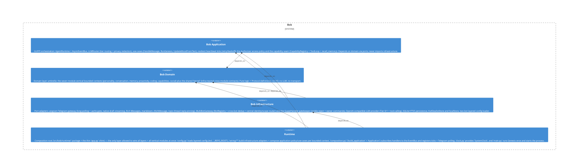

# runtime

**Kind:** service

Composition root (`src/bob/runtime/` package + the thin `app.py` shim) — the only layer allowed to wire all layers + all vertical modules at once: `config.py` loads layered config (incl. `_REPO_ROOT`), `wiring/*` build infrastructure adapters + compose application policy/use-cases per bounded context, `composition.py` (`build_application` + `Application`) subscribes handlers to the EventBus and registers ticks + Telegram polling, `clock.py` provides `SystemClock`, and `main.py` runs Genesis once and starts the process.

**Source:** `src/bob/runtime/`

## Public symbols

- `Application`
- `RhythmWiring`
- `SystemClock`
- `build_application`
- `build_batch_room_reader`
- `build_catch_up_reentry`
- `build_disclosure_guard`
- `build_endorsement_seeder`
- `build_rhythm_wiring`
- `build_room_mood_modulator`
- `build_staleness_reassessor`
- `main`
- `staleness_enabled`

## Relationships

- **part_of**: [bob](../services/bob.md)
- **depends_on**: [bob-application](../domains/bob-application.md), [bob-domain](../domains/bob-domain.md), [bob-infrastructure](../domains/bob-infrastructure.md), [capabilities](../features/capabilities.md), [coding](../features/coding.md), [config](../other/config.md), [conversation](../features/conversation.md), [llm](../other/llm.md), [memory](../features/memory.md), [persistence](../other/persistence.md), [personality](../features/personality.md), [presence](../features/presence.md), [proactivity](../features/proactivity.md), [router](../features/router.md), [runtime-app](../features/runtime-app.md), [social](../features/social.md), [telegram](../other/telegram.md), [usecases](../features/usecases.md)
- **Used by**: [bob](../services/bob.md)

## Documentation

- [services/runtime.md](/docs/services/runtime.md)

## Diagram

